<h1 align="center">
  <a href="https://drive.google.com/file/d/1EM4OFCxiv-046rlXYg-HILrgM6ErL4UL/view?usp=drivesdk">
    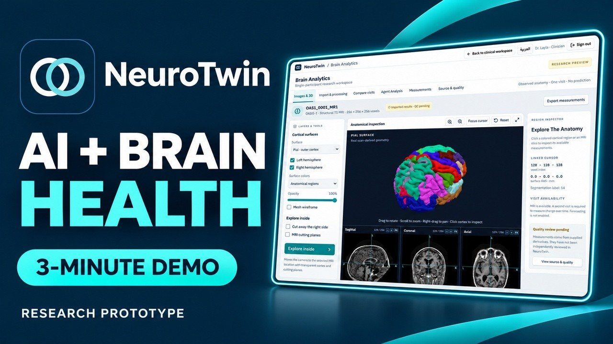
  </a>
</h1>

> **Brain health, earlier. Each person compared only with their own past.**<br>
> *Short home check-ins in Arabic or English build a personal baseline. When something meaningfully changes, a
> clinician sees it, with the day's conditions and every record's provenance, and decides what happens next.*

**Future Health Digital Innovation Challenge · Population Health · Protecting brain health earlier**

[](https://aasif-6379-neurotwin.hf.space/)
[](https://drive.google.com/file/d/1EM4OFCxiv-046rlXYg-HILrgM6ErL4UL/view?usp=drivesdk)
[](https://drive.google.com/file/d/1ryXGpUxw7SC13aR0EqAKlfmMMMG3H76w/view?usp=sharing)
[](docs/BUSINESS_CASE.md)
<br>
[](#see-it-work)
[](docs/INTEGRATION_DESIGN.md)
[](docs/ARCHITECTURE.md)
[](frontend/package.json)
[](backend/requirements.txt)
[](#evidence-that-it-works-as-designed)
[](docs/STATUS.md)
[](LICENSE)

**[Open the live demo](https://aasif-6379-neurotwin.hf.space/)** · [Watch the demo video](https://drive.google.com/file/d/1EM4OFCxiv-046rlXYg-HILrgM6ErL4UL/view?usp=drivesdk) ·
[Read the user manual](https://drive.google.com/file/d/1ryXGpUxw7SC13aR0EqAKlfmMMMG3H76w/view?usp=sharing) ·
[See it work](#see-it-work) · [Business analysis](#business-analysis) · [Research findings](#research-findings) ·
[Run locally](#run-locally)

> [!IMPORTANT]
> **Independent research prototype. Not a medical device.** It does not diagnose, score or predict, and it is not
> approved for clinical use. Every person and record in the demo is synthetic; do not enter real health information.
> Not affiliated with or endorsed by the Department of Health Abu Dhabi.

---

**For the clinician who needs to know whether a person is changing, and for the older adult who would rather not
sit a test in a clinic.** NeuroTwin helps clinicians, adults aged 50–75 and their families to **notice meaningful
change in a person's own brain-health signals over time, and act on it**, using short repeated activities,
self-reports and consented family support. Every result is traceable and every action is clinician-reviewed.

Brain changes can begin years before symptoms, but one screening score is not the full signal: language, education,
hearing, vision, sleep and the day's conditions all move a single result. What matters is **change within the same
person over time**, measured honestly, and a **closed loop** so a concern leads to a named next step and a recorded
outcome rather than being lost.

## At a glance

- **Change against your own past, not against strangers' norms.** The change engine compares a person's earliest
  usable sessions with their latest ones, with a 95% interval, a z-score and a reliable change index. Practice
  sessions are set aside, and it **abstains** when the evidence is too thin.
- **Arabic-first, home-based, a few minutes at a time.** A daily check-in, a reaction activity, picture memory and
  wellbeing questions, in Arabic (right to left) or English, with large type and one task per screen.
- **The day's conditions travel with every result.** Vision, hearing, sleep, a quiet place and feeling unwell are
  asked before each activity, and education and first language once. The clinician sees them beside the result.
- **Clinician in charge.** A "To check" queue, a within-person timeline, care plans and reminders, and concerns that
  follow a care journey (next action, follow-up date, outcome, append-only history).
- **Family support without exposure.** Family members see which activities were done and can send a note, **never
  answers or results**, unless the person chooses to share.
- **A typed assistant with fixed safety rules.** "What is on today?", "I finished the walk", "I need help". Emergency
  words open the help screen before anything else, with no model involved. Any change is read back and recorded only
  after a visible "Yes".
- **Evidence you can audit.** Append-only records labelled observed, self-reported or inferred, with quality,
  protocol version and source; purpose-scoped, revocable consent; an access log that never contains health values.
- **Ready to connect.** A person's records export as an HL7 FHIR R4 Bundle (Patient, Observation, Provenance,
  Consent).
- **Brain Analytics research preview.** Interactive MRI slices, real 3D cortical surfaces, visit comparison and a
  deterministic agent report on OASIS open data. It is a labelled research view, not a diagnosis.

### Where AI is used, and where it is not

| Part | How it works |
|---|---|
| Change engine, quality rules, emergency words | **Deterministic, no model.** The same input always gives the same answer |
| Clinician summary drafts | A language model (Google Gemini or Meta's Model API) writes from stored facts only. A validator refuses invented numbers, diagnoses and advice, and the clinician approves, edits or rejects |
| Assistant answers beyond fixed commands | Only for **demonstration accounts that agreed to it**. Answers pass fixed safety rules (no doses, medicine changes, diagnoses or contact details). Real accounts' words are never sent to an outside model |
| Brain Analytics agent report | A deterministic template over imported measurements. No language model is used in it |

NeuroTwin runs fully **without any AI key**; the model-assisted parts are optional.

## Who it's for

| Who | What they do | What they get |
|---|---|---|
| **Adults aged 50–75**, often with diabetes, high blood pressure, a family history or a memory worry | Short activities at home, 2–3 times a week, in Arabic or English | Reminders, their own records and corrections, help in an emergency |
| **Primary-care doctors and nurses** | Review "To check", decide, write a care plan | Change against the person's own past, with the day's conditions; draft summaries they approve; FHIR export |
| **Memory-clinic and geriatric teams** | Follow people between visits; triage before costly tests | The same view over a longer history |
| **Family members** | Encourage, help with the app, write notes | Which activities were done, never the results |
| **Buyers**: primary-care networks, hospital groups, memory clinics, later insurers and employers | Contract per enrolled person | Quality reporting and records ready for the region's health information exchanges |

## See it work

Screenshots of the running application. The patient, assistant and clinician views were captured from the
[live demo](https://aasif-6379-neurotwin.hf.space/) on 17 November 2026; the family and Brain Analytics views are
earlier captures from the same application. All people and records are synthetic.

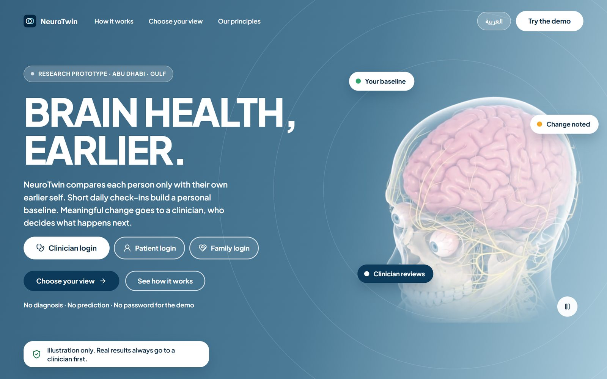

**The personal app**, built for older adults: one task at a time, large type, an urgent-help button on every screen.

<table>
<tr>
<td width="33%" valign="top">
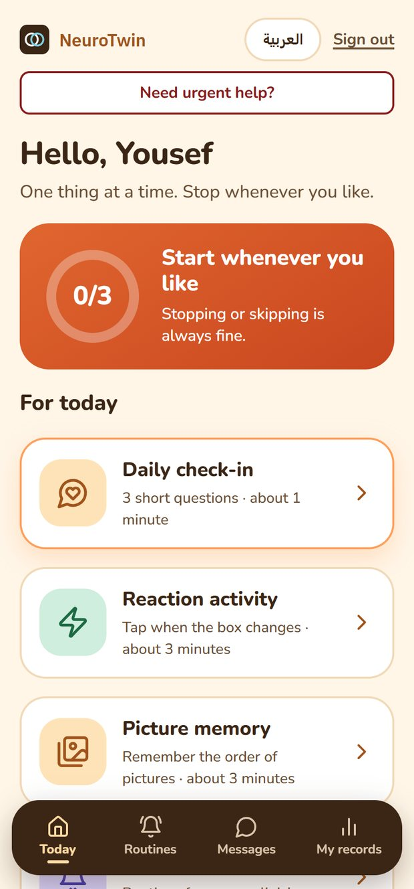

**Today, in English.** Three short activities, each a few minutes. Stopping or skipping is always fine.

</td>
<td width="33%" valign="top">
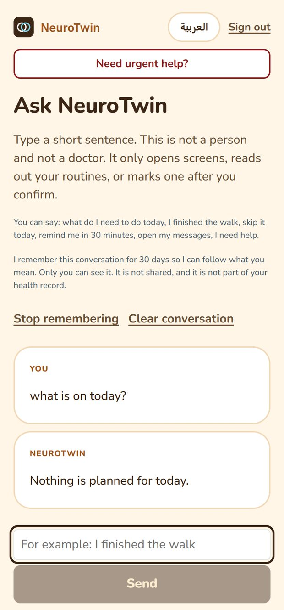

**Ask NeuroTwin.** A typed assistant that opens screens, reads back routines and marks one done after "Yes". It is
not a person and not a doctor.

</td>
<td width="33%" valign="top">
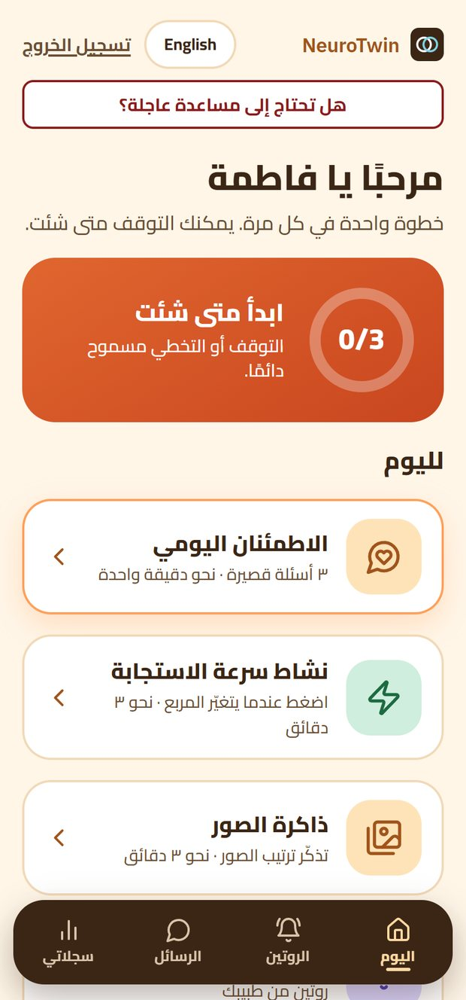

**The same, in Arabic.** Right-to-left layout throughout, with Arabic wording for every screen.

</td>
</tr>
</table>

**The clinician workspace.** Each person is compared only with themselves. Hollow points are doubtful sessions,
the baseline and recent windows are marked, and every change estimate shows its interval, its z-score and what was
left out.

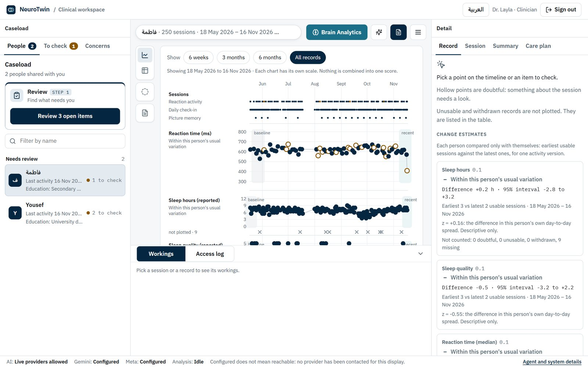

<table>
<tr>
<td width="50%" valign="top">
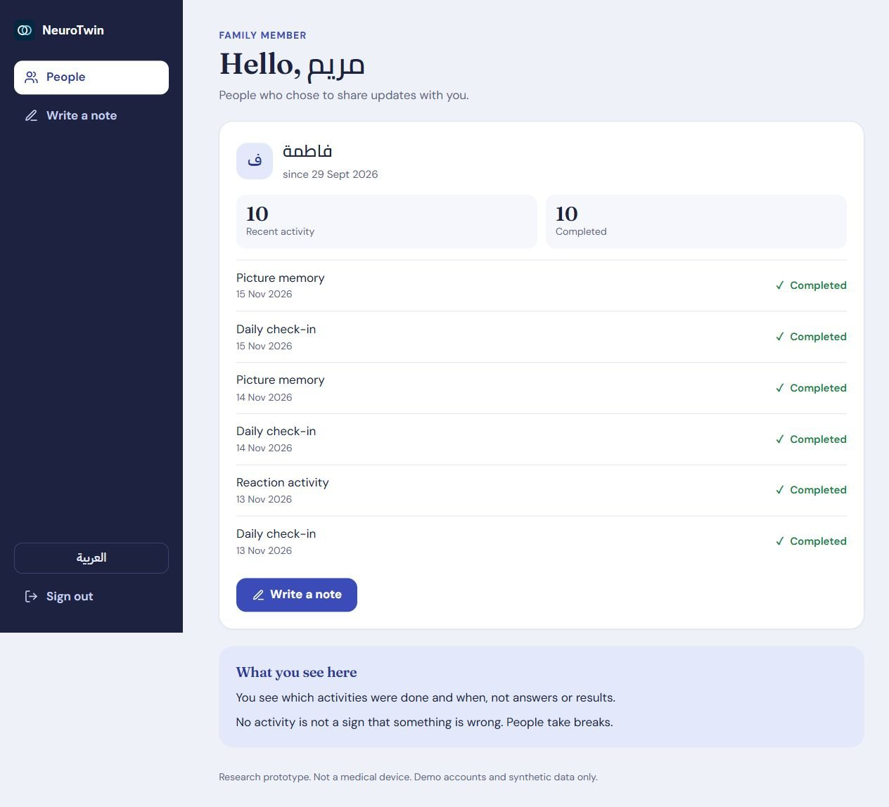

**Family view.** Which activities were done and when, never answers or results.

</td>
<td width="50%" valign="top">
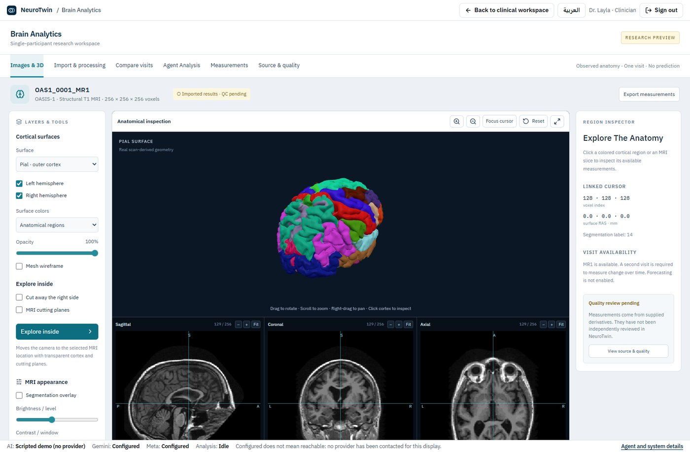

**Brain Analytics (research preview).** A real OASIS-1 scan: 3D cortical surfaces, linked MRI slices, layers and
measurements, with quality review pending.

</td>
</tr>
<tr>
<td width="50%" valign="top">
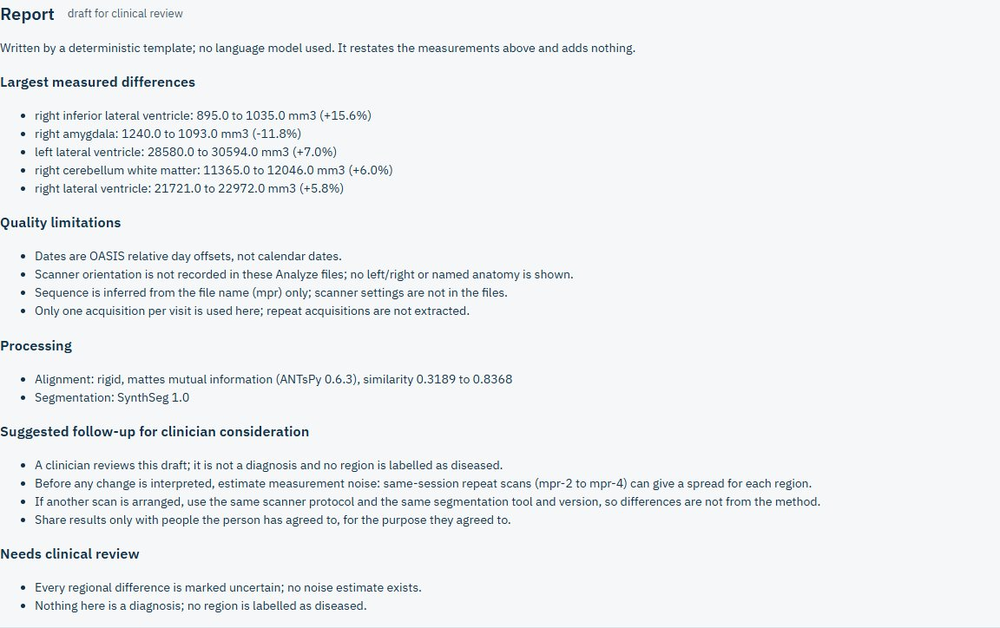

**Agent report.** Written by a deterministic template, with no language model: the largest measured differences,
their limits and suggested follow-up for the clinician to consider.

</td>
<td width="50%" valign="top">
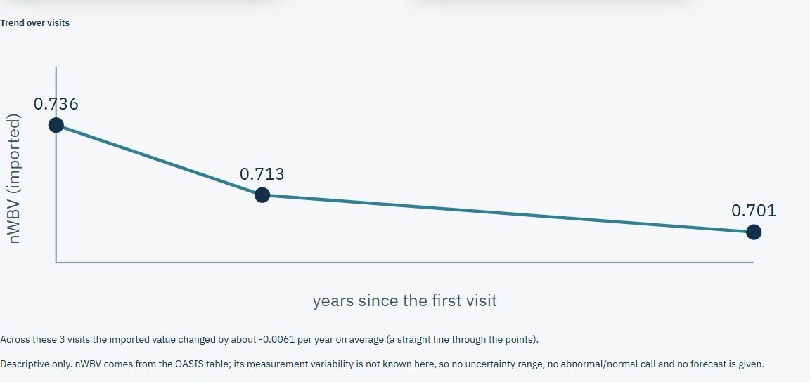

**Across visits.** Imported OASIS-2 measurements over three visits, shown descriptively, with no forecast.

</td>
</tr>
</table>

## Try it (about 5 minutes)

**[Open the live demo](https://aasif-6379-neurotwin.hf.space/)**. No installation and no password: each demo view
is a shared, synthetic account. The free hosting sleeps when idle, so the first load can take a minute.

1. **Older adult (Fatima in Arabic, Yousef in English):** give consent, do the daily check-in and the reaction
   activity (answering "Today's conditions" first), ask the assistant "what is on today?", and type "I need help" to
   see the help screen.
2. **Family (Mariam, Omar):** see which activities were done, never the results; send a short message.
3. **Clinician (Dr. Layla):** open a person, read the timeline and the change estimate (baseline against recent,
   95% interval), decide items in "To check", write a care plan, and follow a concern through its care journey.

The full walkthrough, screen by screen, is in the
**[user manual](https://drive.google.com/file/d/1ryXGpUxw7SC13aR0EqAKlfmMMMG3H76w/view?usp=sharing)**, and
[SUBMISSION.md](SUBMISSION.md) maps the project to the judging criteria.

## How it works

```
 Person (50–75) ─┐  consent per purpose, revocable   ┌─ Family: participation only, never results
                 ▼                                   │
     Activities + check-in + concerns ──► Evidence store (append-only)
                                         observed · self-reported · inferred, quality-labelled, versioned
                                                     │
                       Deterministic core (no model) ▼
                Quality rules ─► Change engine: earliest 3 vs latest 2, 95% interval, abstains when thin
                                                     │
               Model-assisted, always gated ─────────┤  drafts cite stored facts only; validator refuses invented
                                                     │  numbers, diagnoses, advice; clinician approves or rejects
                                                     ▼
            Clinician review ─► care plan & reminders ─► concern ─► care journey (next action, follow-up date,
                                                                    outcome, append-only history)
```

**Safety gates:** no activity without consent · no sharing without a purpose-scoped grant · emergency words open the
help screen first, with no model, and worrying words ("I feel dizzy") get "Do you need urgent help now?" · no change
estimate without enough usable records · no model text without validation · no change to the care plan without a
visible "Yes" and a clinician decision.

More: [architecture](docs/ARCHITECTURE.md) · [status: verified, experimental, planned](docs/STATUS.md) ·
[integration design](docs/INTEGRATION_DESIGN.md) · [DECIDE-AI readiness](docs/DECIDE_AI.md).

## Business analysis

From the full [business case](docs/BUSINESS_CASE.md) (16 November 2026). Facts carry a source; prices, market
sizes and the financial plan are **NeuroTwin's own estimates** and are marked as such.

| | |
|---|---|
| **The need** | People aged 60+ in the GCC go from **3.0 M (2024) to 8.5 M (2050)**. UAE dementia cases are forecast to rise **18-fold** (+1,795%) from 2019 to 2050, the fastest growth in the world, against +166% globally. **61.7%** of dementia goes undetected. |
| **The gap** | No verified competitor offers Arabic or works in the Gulf. Existing tools test once, in a clinic, against age norms biased by education and first language. A 2025 review of 20 Arabic cognitive tools names *detecting change over time* as an open gap. |
| **What we sell** | A clinician-review service: older adults do short activities at home; the clinician sees whether a person has changed **against their own past** and decides. |
| **Who pays** | Health-care providers first (primary-care networks and memory clinics), then payers and employers. Families never pay for results. |
| **Price** *(estimate)* | **AED 15 per enrolled person per month** (about USD 4.08), clinician seats included, plus AED 25,000 setup per site. |
| **Market, 2030** *(estimate)* | TAM **USD 477 M** · SAM **USD 28.7 M** · SOM **USD 1.2 M** |
| **Plan** *(estimate)* | Abu Dhabi 2027, Dubai 2028, Saudi Arabia 2029. Revenue passes operating cost in **2032** at about 110,000 people. Funding need about **USD 4 M**. |

### The problem in numbers

<table>
<tr>
<td width="50%" valign="top">
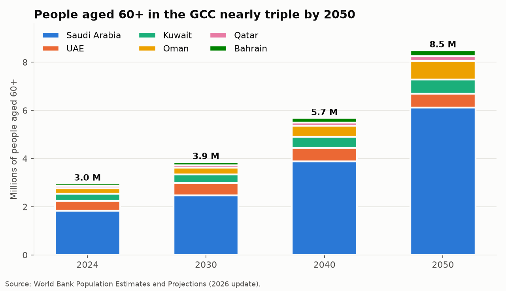

**The Gulf ages fast.** GCC people aged 60+ nearly triple by 2050; Saudi Arabia alone goes from 1.84 M to 6.12 M
(World Bank).

</td>
<td width="50%" valign="top">
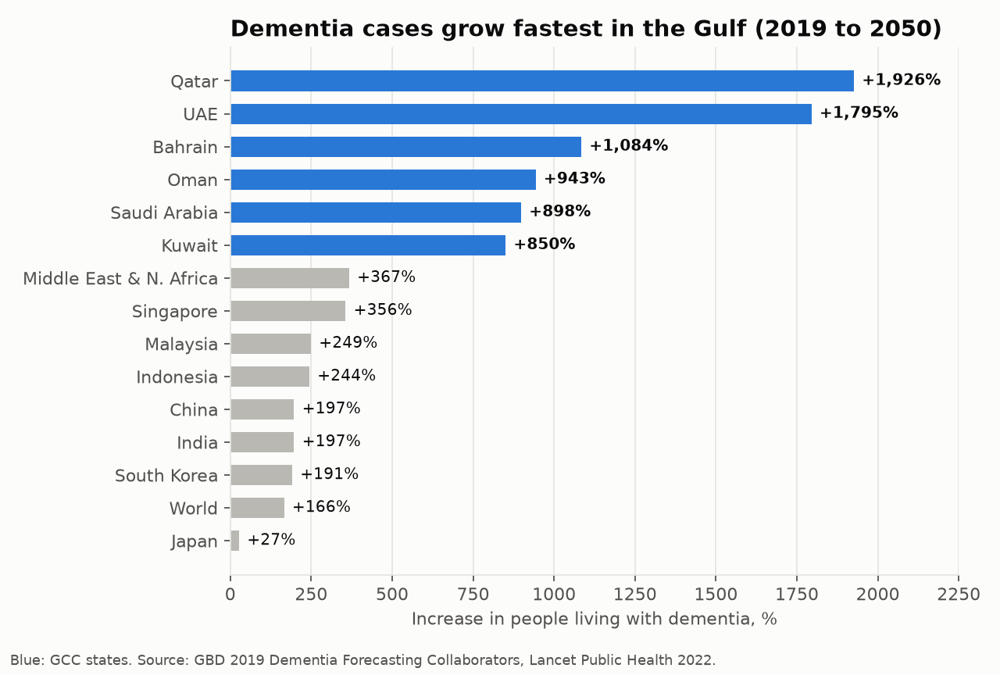

**Dementia grows fastest in the Gulf.** GCC cases go from about 137,000 (2019) to 1.52 M (2050) (GBD 2019 forecast,
*Lancet Public Health* 2022).

</td>
</tr>
<tr>
<td width="50%" valign="top">
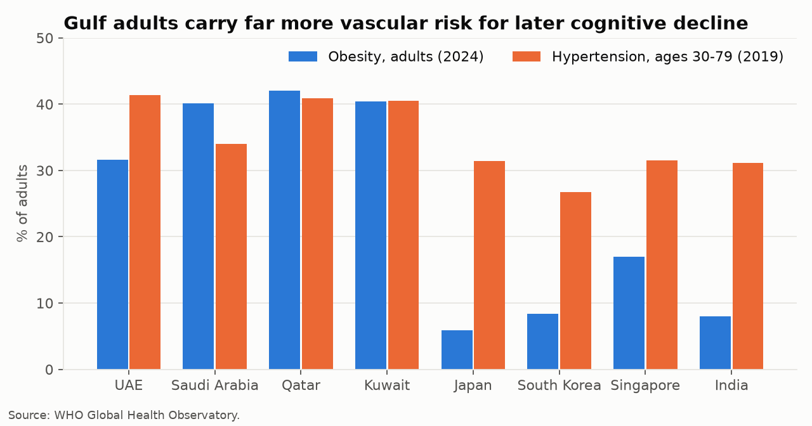

**High vascular risk.** Adult obesity 31.6–42.0% in the UAE, Saudi Arabia, Qatar and Kuwait, against 5.9% in Japan;
hypertension 34–46% (WHO). These are the people primary care already sees for chronic disease.

</td>
<td width="50%" valign="top">
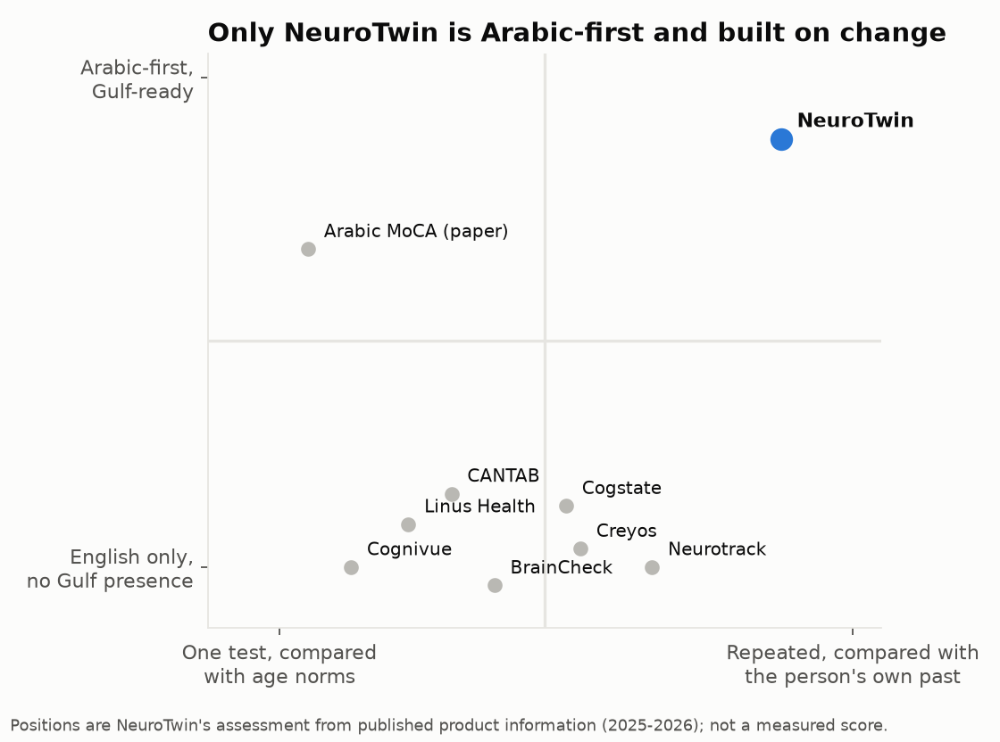

**Only NeuroTwin is Arabic-first and built on change.** Positions are NeuroTwin's assessment from published product
information, not a measured score.

</td>
</tr>
</table>

### Where it fits in the care pathway that is coming

```
Risk or worry ──▶ NeuroTwin: change over time at home ──▶ clinician decides ──▶ blood test ──▶ PET or CSF ──▶ specialist ──▶ treatment
                  (cheap, repeatable, Arabic)                                  (55+, with symptoms;
                                                                               "not a screening test")
```

The FDA cleared the first Alzheimer's blood test in May 2025 for adults 55+ **with symptoms**, and says it is not
for screening; someone has to document the change first. RAND modelled an **18.6-month average wait** for
specialist evaluation in the US. A cheap, documented first step keeps specialists for those who need them.

### Price, cost and margin *(estimates)*

| Tier | Price | Includes |
|---|---|---|
| Clinic programme | **AED 15 per enrolled person per month** (USD 4.08), minimum 100 people | Personal app, family app, clinician seats, FHIR export, support |
| Network or payer programme | AED 10–12 per person per month above 5,000 people | Plus population reporting and integration |
| Setup per site | AED 25,000 once | Integration, training, go-live |
| Research licence | Per study | Arabic and English activities, data export |

**Why AED 15:** about AED 180 a person per year, below one AED 200 clinician review of remotely sent data that Abu
Dhabi already pays for (CPT 99091, DoH Claims and Adjudication Rules, Addendum 30, effective 31 July 2023). A
provider can cover the fee from work it can already bill. Whether a given review qualifies will be confirmed with
DoH and the provider's coding team in the pilot.

<table>
<tr>
<td width="50%" valign="top">
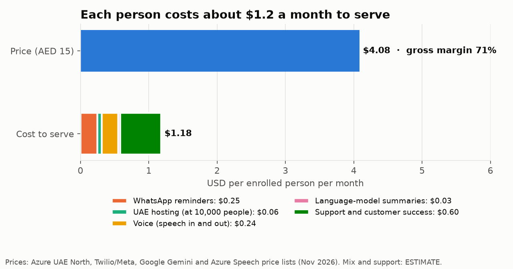

**About USD 1.18 a month to serve, gross margin about 71%**, from 2026 price lists, hosting in the UAE included.

*Since this analysis, the voice features were removed. Without the USD 0.24 voice line the cost to serve is about
USD 0.94 and the gross margin about 77%.*

</td>
<td width="50%" valign="top">
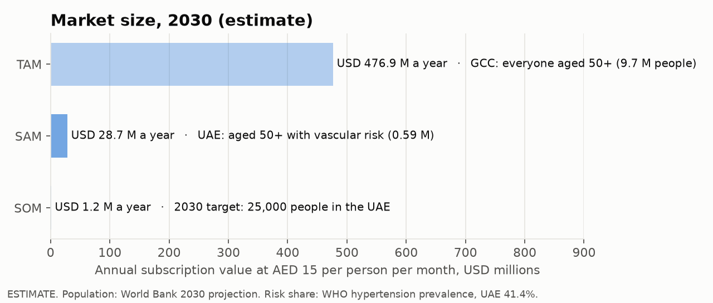

**Market size, 2030.** Built bottom-up from World Bank population, not vendor reports:
TAM 9.73 M people × AED 180 = **USD 477 M**; SAM UAE 50+ with hypertension = **USD 28.7 M**; SOM 25,000 people =
**USD 1.2 M**.

</td>
</tr>
</table>

### Go-to-market and five-year plan *(estimates)*

| Phase | Market | Route |
|---|---|---|
| 2027 | **Abu Dhabi** | One DoH-licensed provider; ethics-approved pilot; FHIR into the provider's record, which feeds Malaffi |
| 2028 | **Dubai** | Private hospital groups and clinics; employers through their insurers; NABIDH |
| 2029 | **Saudi Arabia** | Health clusters and private groups; the largest GCC market |
| 2031 | **Second Gulf state** | Partner-led, reusing the UAE evidence |
| 2031+ | **Asia** | Singapore first (HSA reliance route, Healthier SG); licensing the change engine elsewhere |

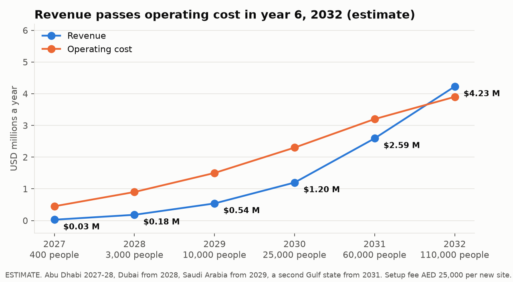

| Year | People enrolled | Price (AED/person/month) | Revenue, USD M | Operating cost, USD M |
|---|---|---|---|---|
| 2027 | 400 | 15 | 0.03 | 0.45 |
| 2028 | 3,000 | 15 | 0.18 | 0.90 |
| 2029 | 10,000 | 14 | 0.54 | 1.50 |
| 2030 | 25,000 | 13 | 1.20 | 2.30 |
| 2031 | 60,000 | 12 | 2.59 | 3.20 |
| 2032 | 110,000 | 11 | 4.23 | 3.90 |

The cumulative shortfall 2027–2031 is about USD 3.8 M, which sets the funding need at about **USD 4 M**. Operating
costs (team, compliance, sales) are planning estimates; UAE salaries and compliance costs are still to be priced.

### Risks

| Risk | Mitigation |
|---|---|
| Providers do not pay without a tariff | Start with providers that have quality targets; price below one billable review a year |
| Regulatory reclassification | No diagnostic claim; clinician decides; device route prepared, not assumed |
| Older adults stop using it | 2–5 minute activities, reminders, family support; completion is a primary pilot outcome |
| Data residency and security | Hosting in UAE regions; ADHICS alignment; audit log; no data to outside AI providers except demo accounts |
| A large competitor adds Arabic | Lead with the within-person method, Gulf integration and local evidence |

Charts are generated by [`docs/business/make_charts.py`](docs/business/make_charts.py). Items that could not be
verified are listed in [section 12 of the business case](docs/BUSINESS_CASE.md#12-to-confirm-before-the-pilot) and
are not used as facts.

## Research findings

From the [deep-research report](docs/business/RESEARCH_REPORT.md). Statements with a citation were read from the
source on 16 November 2026; anything labelled *estimate* is our own arithmetic. (The report suggested AED 30 per
person per month; the business case later lowered this to AED 15 after the Abu Dhabi tariff above was verified.)

1. **Providers pay, not consumers.** Comparable vendors (BrainCheck, Cognivue, Neurotrack, Linus Health) sell to
   providers and health plans, and none publishes a price. US payment is moving to monthly per-patient care
   management (the CMS GUIDE dementia model runs from July 2024 for 8 years), which suits a continuous monitor
   better than a one-off test code.
2. **The buyer in Abu Dhabi is the DoH-licensed provider.** Every DoH-licensed facility must connect to Malaffi,
   which links more than 3,000 facilities; an app vendor does not connect itself. NeuroTwin's FHIR R4 export lands
   in the provider's record system, which already feeds Malaffi.
3. **Running cost is small; fixed costs decide profitability.** Language-model summaries cost USD 0.001–0.014 each,
   and reminders by SMS are the largest variable line (USD 0.1176 per message to the UAE), so WhatsApp or in-app
   reminders come first. Compliance audits, clinical safety and salaries are the real cost lines.
4. **The undiagnosed pool is large, and monitoring finds it.** In Saudi primary care, cognitive screening reached
   21.7% of eligible people in 2023; **34.2%** of those screened got a new MCI or dementia diagnosis, and **71.3%** of
   them had no previously documented concern. MCI affects 15.56% of community-dwelling adults aged 50+.
5. **The scientific gap is change over time, not translation.** A 2025 review of 29 validation studies of 20 Arabic
   cognitive tools found only 3 validated more than once, and flagged missing evidence on detecting change. A
   within-person baseline sidesteps much of the education and dialect bias of population norms.
6. **"Not a diagnostic" is a positioning choice, not an exemption.** The FDA's Computerized Cognitive Assessment Aid
   category explicitly includes "monitoring changes in cognitive function over time". Claim discipline is both the
   cheapest regulatory strategy and a commercial asset; NeuroTwin will never claim prevention, "brain age" or
   dementia detection.
7. **Diagnosis and treatment are arriving faster than specialist capacity.** Blood tests that need symptomatic
   patients, anti-amyloid treatments approved since 2023, and long specialist waits all make a cheap, documented
   triage step more valuable.

**What is still unproven:** no UAE payer has confirmed it will pay for this kind of review, Arabic test–retest
reliability has not been measured, and UAE salary and compliance costs are not yet known. The next three pieces of
work are a paid Abu Dhabi pilot, a classification opinion from the Emirates Drug Establishment, and an Arabic
test–retest study.

## Evidence that it works as designed

| Check | Result | Where |
|---|---|---|
| Backend regression suite | **727 passed**, 14 skipped (optional imaging, research and FHIR libraries not installed), 0 failed | `backend/tests`, CI on Python 3.10 and 3.12 |
| Frontend unit tests and build | **39 passed**; type check and build pass | `frontend`, CI |
| Emergency-phrase rule (English and Arabic) | Tuning set: 132/132 emergencies caught, 94/95 ordinary sentences left alone; held-out rounds and every miss recorded | [EMERGENCY_BENCHMARK.md](docs/EMERGENCY_BENCHMARK.md) |
| Change engine on 16,000 simulated people | False alarms on stable people 4.8% (95% CI 3.9–5.8%); flags 61% of 3-SD and 81% of 4-SD slowings; abstains when records are too few | [CHANGE_ENGINE_BENCHMARK.md](docs/CHANGE_ENGINE_BENCHMARK.md) |
| Server response time (in process) | Median 6–19 ms for reads; 95th percentile under 65 ms | [LATENCY_BENCHMARK.md](docs/LATENCY_BENCHMARK.md) |
| Agent guard-rail scenarios | 71/71 (altered numbers, unsupported claims, diagnosis requests, provider failure) | [AGENT_EVAL_REPORT.md](docs/AGENT_EVAL_REPORT.md) |
| Test–retest analysis code | ICC, SEM and minimal detectable change reproduce Shrout & Fleiss exactly; pilot protocol for 39 people | [RELIABILITY_STUDY.md](docs/RELIABILITY_STUDY.md) |
| Subgroup analysis | Ready to run on pilot data by education, first language and device | [SUBGROUP_ANALYSIS.md](docs/SUBGROUP_ANALYSIS.md) |
| FHIR R4 export | Patient, Observation (UCUM units, data-absent reasons), Provenance, Consent; R4 rules checked in 8 tests | [INTEGRATION_DESIGN.md](docs/INTEGRATION_DESIGN.md) |

These are software checks on developer-written and synthetic cases. **They are not clinical accuracy, sensitivity or
specificity figures**, and no claim of clinical benefit is made. All runs:
[BENCHMARK_REPORT_2026-11-16.md](docs/BENCHMARK_REPORT_2026-11-16.md).

## Assumptions and limitations

- Activities are prototype digital tasks, not validated instruments; change-engine settings are engineering defaults
  awaiting statistician and clinician review.
- The reliable change index uses an assumed test–retest reliability (marked provisional on screen) until a
  reliability study measures one. No reliability has been measured on real people.
- Today's conditions label results for the clinician but do not adjust them, because no normative adjustment exists
  yet.
- FHIR R4 export is download only. No connection to Malaffi or any health record exists yet; the route is designed
  and must be confirmed with DoH and Malaffi.
- Arabic wording has not yet had a native Gulf clinical reviewer, and the app has not yet been tested with older
  adults on real devices.
- Brain Analytics shows one prepared OASIS-1 case and OASIS-2 measurements as a labelled research view; quality review
  of the imported measurements is pending.

**Path to pilot:** clinical review → ethics approval (Abu Dhabi DoH) and a data-residency choice → usability study
with adults aged 50–75 and families → reliability study and a manual-versus-assisted review comparison, reported
against DECIDE-AI → integration study with one record system.

## Run locally

You need **Python 3.10 or newer** and **Node.js 18 or newer**.

```powershell
cd D:\NeuroTwin
.\start.ps1
```

The script creates a Python environment, installs everything, builds the web app and starts the server. Open
**http://127.0.0.1:8000** and choose a view. No username or password is needed in demo mode. To include Brain
Analytics with the prepared imaging data, run `.\start-imaging.ps1` instead.

If PowerShell blocks the script, run once: `Set-ExecutionPolicy -Scope CurrentUser RemoteSigned`.

### Demo views

| View | Opens as |
|---|---|
| Older adult | Fatima (Arabic) or Yousef (English) |
| Family member | Mariam or Omar |
| Clinician | Dr. Layla |

The demo accounts are shared by everyone using the server, so password changes and "sign out other devices" are
switched off for them. On a server started with `NEUROTWIN_SEED_DEMO=0`, one-click entry is off and the front page
shows a username and password form instead.

<details>
<summary><b>By hand, development, tests and fresh demo data</b></summary>

```powershell
cd D:\NeuroTwin\backend
python -m venv .venv
.\.venv\Scripts\Activate.ps1
pip install -r requirements.txt

cd ..\frontend
npm install
npm run build

cd ..\backend
python -m uvicorn app.main:create_app --factory --port 8000 --no-access-log
```

Keep `--no-access-log`: uvicorn's own access log prints raw URLs, which include person ids.

**While developing the web app:** run the server as above, then in a second terminal `cd frontend` and `npm run dev`,
and open http://127.0.0.1:5173. Changes reload live.

**Tests:**

```powershell
cd D:\NeuroTwin\backend
.\.venv\Scripts\Activate.ps1
python -m pytest -q
```

**Start again with fresh demo data:** stop the server, delete `backend\neurotwin.db`, start it again.

</details>

<details>
<summary><b>Settings</b></summary>

| Variable | Default | Meaning |
|---|---|---|
| `NEUROTWIN_DATABASE_URL` | SQLite file `backend/neurotwin.db` | Any SQLAlchemy URL, e.g. PostgreSQL |
| `NEUROTWIN_SEED_DEMO` | `1` | Demo mode: load the synthetic demo accounts and allow one-click entry |
| `NEUROTWIN_DEMO_PASSWORD` | `neurotwin-demo-2026` | Password of the demo accounts (only for password sign-in) |
| `NEUROTWIN_SECURE_COOKIES` | `0` | Set to `1` when served over HTTPS (any deployment) |
| `NEUROTWIN_SESSION_HOURS` | `8` | How long a sign-in lasts |
| `NEUROTWIN_SEED_HISTORY` | `0` | `1` adds six months of synthetic history to the demo people |

Model keys, daily call caps and the imaging settings are listed in `backend/.env.example` and the docs linked from it.

</details>

<details>
<summary><b>Model providers (optional)</b></summary>

NeuroTwin runs fully without any AI key. To use the model-assisted features, add keys for Google Gemini, Meta's
Model API, or both:

```powershell
cd D:\NeuroTwin\backend
copy .env.example .env      # then open .env and paste your keys
.\.venv\Scripts\python.exe scripts\list_models.py
```

The script lists the models each key can use and never prints a key. Put the provider and model you choose in
`.env` (`NEUROTWIN_AI_PROVIDER`, `GEMINI_MODEL` or `META_MODEL`), then check a real draft end to end:

```powershell
.\.venv\Scripts\python.exe scripts\try_draft.py --all
```

`backend/.env` is ignored by git: never commit it, and never send real health data to a provider. Every
model-written draft must pass the output validator (`backend/app/validator.py`) and then a clinician's review.

</details>

<details>
<summary><b>Deploy (free Hugging Face Space)</b></summary>

The live demo runs on a free Hugging Face Space. `deploy/huggingface/prepare-space.ps1` builds the upload folder
(code, built web app and imaging data; no secrets or databases), and
[deploy/huggingface/DEPLOY.md](deploy/huggingface/DEPLOY.md) has the step-by-step guide.

</details>

## Folders

```
backend/   FastAPI service: evidence core, consent, sharing, quality rules, change engine, assistant, tests
frontend/  React + TypeScript web app: personal app, family view, clinician dashboard, Brain Analytics
docs/      Status, architecture, business case, research, benchmarks, integration and evaluation plans
deploy/    Hugging Face Space setup
```

## Contributing and licence

Work happens on branches and reaches `main` through `develop` and pull requests, with CI on every pull request. See
[CONTRIBUTING.md](CONTRIBUTING.md). Changes by version: [CHANGELOG.md](CHANGELOG.md).

[MIT](LICENSE) for NeuroTwin's code. Data (OASIS), media, fonts and packages keep their own terms:
[THIRD_PARTY_NOTICES.md](THIRD_PARTY_NOTICES.md).
