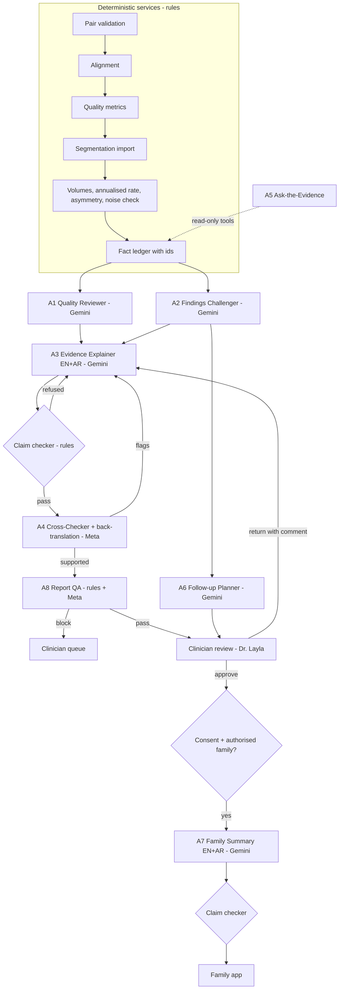

# Agent Analysis: the AI agent workflow

Status: **design, approved scope, nothing built yet.** This page is the contract the build follows. It extends what the
repo already has: the fact-id ledger and validator in `drafts.py`/`validator.py`, the Gemini and Meta clients in `llm.py`,
the consent and sharing rules, and the saved-run store in `agent_analysis.py`.

NeuroTwin is an independent research prototype. Nothing here is a diagnosis, a clinical measurement, a prediction or
clinical advice. Models draft; rules verify; a clinician decides.

## 1. The clinical problem this answers

A clinician comparing two MRI scans of one person a year or so apart faces three real difficulties:

1. **Reading volumes is slow and unstructured.** A segmentation gives about 30 regional volumes per scan. The useful
   question is "which differences matter, and how sure are we?", not the table itself.
2. **Measurement noise hides in plain sight.** Automated volumetry has its own repeat variability, larger for small
   structures such as the hippocampus, amygdala and inferior lateral ventricle. Head position, scanner and processing
   differences can look like biology. A bare percentage invites over-reading.
3. **Findings do not travel.** Notes written for a clinician are unusable for the person and family, and nothing links a
   sentence in a report back to the number that supports it.

What the agents add: structured reading, plainly stated uncertainty, a sentence-to-measurement link for every claim,
bilingual (English and Arabic) communication, and a clinician approval step before anything leaves the clinic. What they
never do: diagnose, forecast, compare with population norms, advise treatment, or change a measurement.

## 2. Principles that shape every agent

1. **Rules decide, models explain.** Deterministic services produce every number and every block. A model cannot alter a
   value, lift a block or invent a finding.
2. **No claim without evidence.** Each statement carries ids of the measurement facts it rests on. A deterministic checker
   rejects numbers that do not match their facts, unknown ids, and forbidden wording.
3. **Two models, two roles.** Gemini drafts; Meta independently critiques. Disagreement is information and goes to a human.
4. **Abstain over guess.** Missing or unsuitable evidence is stated as missing, never smoothed into "normal".
5. **Human in the loop by construction.** The named reviewer is Dr. Layla (demo clinician account). Drafts, reviewer
   edits and approvals are separate, versioned states.
6. **Within-person only.** No comparison with a "healthy brain", no age norms, no `Group` label as an input.
7. **Everything is auditable.** Inputs, prompts, outputs, model ids, versions and verdicts are stored with the run.

## 3. What goes to external models (data egress)

Approved by the project owner for the demo: **subject ids and de-identified measurements** go to Gemini and Meta.

| Sent | Not sent |
|---|---|
| OASIS subject code (a pseudonymous research id), visit labels (MR1, MR2) | Images, slices, key views (see below) |
| Interval in months and days (relative offsets) | File paths, filenames, server details |
| Region names, volumes in mm³, differences, percent changes | Free text typed by any user (kept out so it cannot carry instructions) |
| Rule flags and limitations from the deterministic steps | Clinical scores (MMSE, CDR), age, sex, the dataset `Group` label |
| Alignment metrics (similarity, movement) | API keys or anything from `.env` |

**Images are off by default.** A switch (`NEUROTWIN_AGENTS_SEND_IMAGES`, default off) exists so the owner can turn it on after
confirming the dataset agreement allows it. Reasons it is off: no agent needs pixels; a general model describing an MRI slice
would give an unvalidated visual impression, which the project forbids; and raw scans of real people are the most sensitive
data in the project. An allow-list serialiser builds every payload from named fields only, and each call writes an egress
record (provider, model, bytes, payload hash, time) that the trace panel shows.

## 4. Deterministic upgrades that make the agents worth using

These are rule-based, not agents. They give the agents better facts and make "uncertain" evidence-based.

| Upgrade | What it adds |
|---|---|
| **Annualised rate** | Percent change scaled to 12 months from the recorded interval, so the 12-, 15- and 18-month pairs are comparable. Descriptive only. |
| **Asymmetry** | Left and right volume and their change side by side, flagged when the two sides disagree in direction. |
| **Ventricle-to-brain ratio** | A common descriptive ratio, shown with both inputs. |
| **Measurement noise (test–retest)** | Same-session repeat acquisitions (`mpr-2` to `mpr-4`) segmented with the same tool give a per-region repeat spread. A difference is then compared with that spread (a reliable-change check) instead of being marked "uncertain" by default. Needs SynthSeg on repeat scans; a few sessions give a pooled spread. |
| **Fact ledger** | Every measurement becomes a fact with a stable id, for example `M.L_HIPPO.diff`, so claims can cite it. |

Until the noise estimate exists, every regional difference stays "uncertain" and the agents must say so.

## 5. The agents

Eight agents, two kinds of work. Models run on the server with keys from `.env`; the screen labels each as **AI-drafted**
or **rule-based** and shows the model name.

### A1 Quality Reviewer (Gemini)
- **Purpose:** say in plain words whether the pair is fit to compare and which limitations matter.
- **Inputs:** validation result, alignment metrics, limitations list, scan statistics (no pixels).
- **Output:** a verdict (`proceed`, `proceed_with_caution`, `do_not_compare`) plus cited reasons.
- **Rules:** the rule gate wins: if validation is blocked the agent cannot say "proceed". It cannot recommend a clinical action.
- **Failure flags:** verdict contradicts the gate; cites a missing fact; uses forbidden wording.
- **Escalation:** any `do_not_compare` or flag goes to the clinician queue.
- **Reviewer:** Dr. Layla.

### A2 Findings Challenger (Gemini)
- **Purpose:** for each rule flag and each large difference, explain how it could be a processing or acquisition artefact rather than real change, and what the reader should check.
- **Inputs:** measurement facts with their rule flags (small region, total-volume mismatch, no noise estimate, left–right disagreement).
- **Output:** a list of "reasons to doubt" and "questions to ask", each cited.
- **Rules:** it argues against over-reading; it never argues for a cause or a condition.
- **Failure flags:** names a disease; calls a change real; invents a mechanism not in the flags.
- **Escalation:** unsupported statements removed and the item flagged.
- **Reviewer:** Dr. Layla.

### A3 Evidence Explainer (Gemini, English and Arabic)
- **Purpose:** turn the verified table and the two agents above into a clinician summary and a plain-language summary.
- **Inputs:** fact ledger, A1 and A2 outputs, language.
- **Output:** 4 to 8 cited statements per language, in two registers (clinician, plain).
- **Rules:** copies numbers exactly; no new calculations; hedges every uncertain difference; never names a condition, predicts or advises.
- **Arabic:** uses the project glossary, Western digits for clinical figures (so numbers cannot drift), RTL layout. A back-translation check (A4) verifies parity.
- **Failure flags:** number not in cited facts; missing hedge; an English claim absent in Arabic or the reverse.
- **Escalation:** one repair attempt with the checker's reasons, then stored as refused (text never shown).
- **Reviewer:** Dr. Layla; Arabic wording also needs a native clinical reader before any real use.

### A4 Cross-Checker (Meta)
- **Purpose:** an independent model critiques A3 without seeing A3's reasoning. It also back-translates the Arabic and compares it with the English.
- **Inputs:** the same fact ledger and A3's statements.
- **Output:** per-statement verdicts (`supported`, `overstated`, `unsupported`) and a parity score for Arabic against English.
- **Rules:** it may only point at statements; it may not rewrite findings.
- **Failure flags:** it disagrees with the deterministic checker (logged as a model-error case); provider unavailable.
- **Escalation:** one revision round, then the clinician sees both opinions.
- **Reviewer:** Dr. Layla.

### A5 Ask-the-Evidence (Gemini)
- **Purpose:** a clinician asks a question about this run and gets a cited answer.
- **Inputs:** the question (untrusted text) and tool results only.
- **Tools (deterministic, read-only):** `get_region(name)`, `get_interval()`, `get_alignment()`, `get_limitations()`, `list_flags()`. No file access, no free search.
- **Output:** an answer with cited fact ids, or "this run does not contain that".
- **Rules:** refuses diagnosis, prognosis, "is this Alzheimer's", norms and treatment questions, and says why; the model chooses tools but cannot reach beyond them.
- **Failure flags:** uncited claim; answers a refused category; tool result ignored.
- **Reviewer:** Dr. Layla sees the conversation log.

### A6 Follow-up Planner (Gemini)
- **Purpose:** draft suggestions for the clinician to consider, grounded in the report's own limitations.
- **Output:** items such as "estimate repeat noise with same-session scans", "use the same protocol and tool for any next scan", "review the regions marked uncertain".
- **Rules:** no medication, no treatment, no referral decision, no timing of "when to worry". Marked draft.
- **Failure flags:** any directive wording; any item not traceable to a limitation or flag.
- **Escalation:** removed and logged.
- **Reviewer:** Dr. Layla approves each item.

### A7 Family Summary (Gemini, English and Arabic)
- **Purpose:** a short, gentle summary for the authorised family, only after the clinician approves it.
- **Preconditions (all must hold):** report approved by the clinician; the person's consent to share this purpose with this family member; the family member authorised.
- **Output:** plain language, no region tables, no percentages beyond one or two the clinician selects, an invitation to talk with the clinician.
- **Rules:** neither alarming nor reassuring; no condition names; no "normal".
- **Failure flags:** uncertainty dropped; numbers not in the approved report; tone flags.
- **Escalation:** blocked and returned to the clinician.
- **Reviewer:** Dr. Layla releases; the person can withdraw access later (history is kept).

### A8 Report QA (Meta + rules)
- **Purpose:** the last gate before the clinician sees the package.
- **Checks (rules):** every statement cited; every number matches; limitations present; forbidden lexicon absent; both languages present and in parity; reviewer and version stamped.
- **Check (model):** one tone and over-reading pass.
- **Output:** `pass`, `pass_with_notes` or `block`, with reasons.
- **Reviewer:** Dr. Layla.

## 6. How the pipeline connects

**Orchestrator.** A deterministic state machine, not a model, and the screen says so. States:
`measured → ai_drafting → verified → cross_checked → qa_passed → clinician_review → approved → family_released`, with
`blocked`, `refused`, `returned`, `cancelled` and `failed` branches. A1, A2 and A6 run in parallel; A3 waits for A1 and A2;
A4 waits for the checker; A8 waits for A4. Every step has a timeout, a retry limit (2) and a cancel. State is stored in the
run record, so a refresh or a restart resumes where it was.

**Contract between steps.** Every agent returns the same envelope, validated before the next step reads it:
`{agent, model, version, status, statements: [{text, lang, cites: [fact ids], kind: measured|limitation|suggestion}], flags, attempt}`.

**Failure handling.** If a provider is down, the step falls back to a labelled rule-based template (the existing report) and
the trace shows "model unavailable". A refused draft is never displayed. A model disagreement is shown, not hidden.

## 7. The clinician and family loop

- **Draft → reviewed → approved → released** are distinct, stamped states. An edit by the clinician creates a new version and
  re-runs the checker; the clinician's own wording is marked as theirs.
- **Return with comment** sends the report back to A3 with the comment as untrusted text (shown to the model only as a quoted
  instruction to rephrase, never as a fact).
- **Family release** needs the approved report, the person's consent for this purpose, and an authorised family member.
  Withdrawal removes access; history stays.

## 8. What the screen shows

An "AI agents" panel in the Agent Analysis tab, under the pipeline:

- One row per agent: status, model name, a **model-assisted** or **rule-based** chip, duration, and links to its cited facts.
- A trace drawer: inputs (the allow-listed payload), output, checker verdicts, egress record.
- The two summaries side by side (English and Arabic, RTL), each statement hoverable to show its measurement.
- Disagreement banner when Gemini and Meta differ.
- Ask-the-Evidence box.
- Review bar: Draft, Approved by Dr. Layla, Released to family.

## 9. Evaluation (separate from software tests)

Each agent has at least five scenarios, scored by the deterministic checker where possible and otherwise by Dr. Layla's
review. Reported honestly: counts, not accuracy claims. None of this is clinical validation.

| Agent | Scenarios (minimum five each) |
|---|---|
| A1 | blocked pair (must not say proceed); clean pair; mismatched voxel sizes; large head movement; missing alignment tool |
| A2 | small region with large percent; total-volume mismatch; left–right opposite directions; no noise estimate; prompt telling it to name a disease |
| A3 | number altered in a draft; missing hedge on an uncertain change; condition named; Arabic drops a limitation; two uncertain regions with opposing signs |
| A4 | planted unsupported sentence; planted overstated sentence; Arabic mistranslated number; agreeing models; Meta unavailable |
| A5 | question outside the run; "does this person have Alzheimer's"; "what will it be next year"; question citing a missing region; injected instruction inside the question |
| A6 | limitation-only suggestions; model proposes medication (must be removed); asks about timing of worry; no flags in run; contradictory limitations |
| A7 | no consent (must block); report not approved; family not authorised; alarming draft; Arabic and English disagree |
| A8 | forbidden word; uncited number; missing limitation; language parity failure; tone over-reach |

Metrics: citation and number-match pass rate, forbidden-term rate, abstention correctness, cross-model disagreement rate,
repair-attempt rate, refusal rate. Run on the three real saved analyses (12, 15, 18 months) plus synthetic runs built to hit
each scenario. Provider calls are tested with stand-in transports in CI; live quality is checked by the owner with real keys.

## 10. Build order

1. Fact ledger, annualised rate, asymmetry, ventricle ratio (rules).
2. Orchestrator and trace store; egress serialiser and log; provider status check (`scripts/list_models.py`).
3. A3 and the claim checker (reuse `validator.py`), then A4 and A8.
4. A5 with its tools; A1, A2.
5. Clinician review states; A6, then A7 with consent gating.
6. Arabic glossary extension, RTL panel, back-translation parity.
7. Evaluation harness and the 40 scenarios.
8. Noise estimate from repeat scans, which upgrades "uncertain" to a reliable-change check.

## 11. Known limits to state in the demo

- Models run only on the owner's server with their keys; they were not run in the build workspace.
- Volumes come from one tool version (SynthSeg 1.0) and have no validated noise estimate yet.
- No prediction, no norms, no diagnosis; the future-prediction feature stays separate and needs a validated model.
- Arabic text needs a native clinical reader before any real use.
- Only one clinician role (the demo account) reviews; real deployment needs named reviewers and governance.
