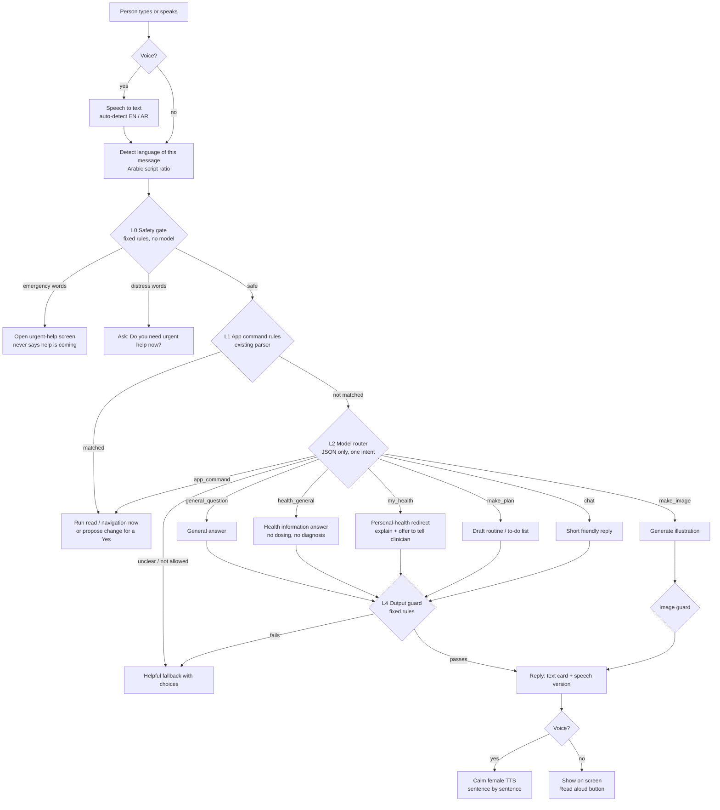
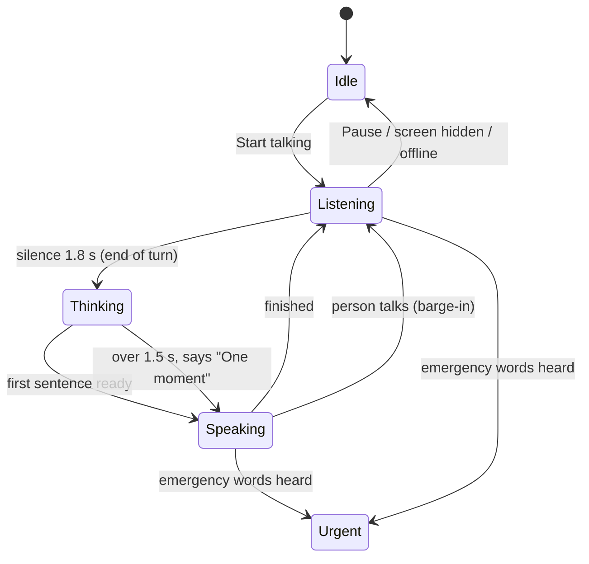

# Patient assistant redesign: text and voice workflow (for review)

**Status:** phase A built, 16 November 2026: model router and answers (`backend/app/assistant_ai.py`), output guard,
routine draft with Save (`/api/me/routine`, migration 0010), helpful fallback, calm female voice (Sulafat, speed 0.9),
42 tests in `backend/tests/test_assistant_ai.py` plus the existing assistant and companion tests. Checked in the running
app with the live Gemini model in English and Arabic. Phase B (pictures) is not built; a picture request gets a fixed
"I can't make pictures yet" reply. Decisions taken: model answers for demonstration accounts with `assistant_model`
consent only; Modern Standard Arabic in a warm tone; Sulafat as the default voice.
**Scope:** the patient's "Ask" screen (text) and the voice companion. They will share one brain.

---

## 1. Why the current assistant feels poor

| What you saw | Cause in the code today |
|---|---|
| "I did not understand that, so I did nothing" for most requests | `assistant.parse()` is a fixed list of English and Arabic word patterns. Anything that is not a task action, a screen name or a greeting ends as `not_understood`. Any sentence longer than 6 words is refused on purpose (`assistant.py`, "a long, mixed sentence ... ask again"). |
| General questions ("population of India") get no answer | No component answers questions. The only model step (`companion_nlu.py`) may only pick a menu item, and only behind `NEUROTWIN_COMPANION=1` on a demo account with consent. |
| A daily routine or to-do list cannot be made | There is no "plan" or "draft" capability; the care plan is set by the clinician. |
| No images | There is no image-generation path for the patient. |
| The voice sounds too energetic | The server voice is told to be "very friendly, cheerful and energetic" (`llm.py` `speak()`). The default voice is `Puck`, which Google describes as "Upbeat". The browser fallback raises the pitch (`pitch = 1.1`) and prefers male voices (`speak.ts` `pickVoice`). |
| The fallback message is a dead end | `asNot_understood` gives no next step and offers no choices. |

The safety core is good and stays: emergency words first, a confirmation before anything changes, no diagnosis, an audit log without the person's words. The redesign adds understanding and answering **around** that core. It does not loosen it.

---

## 2. Design principles

1. **Safety before intelligence.** Emergency and distress checks run first, with no model, every time, in both languages.
2. **The fast rules first, the model second.** Known app commands ("I took my walk", "snooze 10 minutes") stay instant, offline and free. The model is used only when the rules do not match.
3. **The model proposes, the server decides.** Changes to the person's records still need the person's own "Yes". The model can never act directly.
4. **Answer, don't refuse.** Every message gets a useful reply: an answer, a question back, or a clear "I can't help with that, but your clinician can", together with what the assistant *can* do.
5. **Native in both languages.** Replies are written directly in the person's language, not translated. Arabic is Modern Standard Arabic in a warm Gulf register, with Arabic digits as the person prefers.
6. **Calm medical voice.** The voice is warm, steady and unhurried, like an experienced nurse. It is never excited or salesy.
7. **Same brain for text and voice.** Voice is text plus speech in and speech out. One router, one set of rules, one test suite.

---

## 3. The workflow



### L0: Safety gate (unchanged and always first)
- The existing `_EMERGENCY` and `_DISTRESS` rules, in English and Arabic.
- They also run **on the model's input and on its output**. A model answer that contains emergency advice is replaced by the urgent-help card.

### L1: App command rules (kept, made friendlier)
- The current parser stays for known commands: done, not today, snooze, today's list, open a screen, recap, start a concern.
- Remove the rule that refuses every sentence over 6 words. Long sentences now go to the router instead of being refused.

### L2: Model router (new)
One small, fast model call that returns **JSON only**:

```json
{"intent": "general_question | health_general | my_health | make_plan | make_image | app_command | chat | unclear | not_allowed",
 "language": "en | ar",
 "app_command": {"tool": "...", "item": 2, "minutes": 10, "screen": "..."} ,
 "topic": "short label, no personal details"}
```

- The server checks the JSON against fixed lists, as `companion_nlu.py` does today. An unknown intent becomes `unclear`.
- The person's words are marked as data, not instructions (the prompt-injection rule already used in `companion_nlu.py`).
- Timeout 4 s. On timeout or error, the helpful fallback is used.

### L3: Handlers

| Intent | What happens | What the model is given |
|---|---|---|
| **general_question**: "What is the population of India?", "How far is the moon?", "Tell me a joke" | Short, factual answer: 2-4 sentences in text, 1-2 sentences spoken, with "Shall I tell you more?". For facts that change (populations, prices, news), the answer gives the year of the figure. With search grounding switched on (optional, section 7), it also cites the source. | The question only. **No** name, tasks, results or history. |
| **health_general**: "Why is sleep important?", "What foods help memory?" | General, everyday information from public-health knowledge. It ends with "Your clinician can tell you what fits you." It never gives doses, never says to stop or start a medicine, and never diagnoses. | The question only. |
| **my_health**: "Is my memory getting worse?", "What does my result mean?" | No interpretation. A kind explanation that the clinician reviews the records, then the offer "Would you like to send a note to your clinician?", which starts the existing concern flow. | Nothing; this reply is a fixed template. |
| **make_plan**: "Make me a daily routine / to-do list" | A drafted routine card: morning, afternoon and evening, 6-10 items. It includes the person's **existing** tasks from today's plan at their times, marked "from your care team", plus simple items they can choose (water, a walk, rest, a call to family). Buttons: **Save as my list**, **Change**, **Read aloud**. Saving creates *personal* reminders after a confirmation. The clinician's care plan is never changed. | Demo accounts: today's task titles and times. Real accounts: nothing personal until a UAE-approved model is in place (section 6); the draft is generic and the person adds their tasks. |
| **make_image**: "Create an image of my daily activities" | An illustration (a calm, friendly drawing, not a photo) of the routine: for example a morning walk, water, reading and tea with family. It is labelled "Picture made by AI". Buttons: **Save**, **Make another**. | A prompt the **server** builds from a fixed template plus activity words (walk, water, reading). No names, faces of real people, medical scenes or text from the person goes in directly. |
| **chat**: hello, thanks, how are you | Short and warm. On a first greeting it says once what the assistant can do. | Nothing; the reply comes from templates. |
| **unclear** | "I'm not sure I understood. I can: tell you today's plan, answer a question, make a daily routine, or make a picture. Which would you like?" with 4 buttons. | n/a |
| **not_allowed**: medication dosing, diagnosis, harmful or illegal requests, others' data | A clear, kind "I can't help with that" plus the right person to ask (pharmacist, clinician) and what the assistant can do. | n/a |

### L4: Output guard (fixed rules, no model)
Every model reply is checked before the person sees or hears it:
- **Language matches** the message (Arabic in, Arabic out).
- **Length** is capped: text 120 words, speech 45 words.
- **Health rules**, reusing the vocabulary of `validator.py`:
  - No doses, no "stop or start taking".
  - No diagnosis or prediction about *this* person.
  - No "nothing to worry about".
  - No claim that help is coming.
- **No links, phone numbers or e-mail addresses** that the model made up.
- **The emergency check runs again** on the output.

If a reply fails, the person gets the helpful fallback, and the audit log records `assistant.answer_blocked` with no words.

### L5: Reply rendering
Each answer has two forms:
- **Screen text:** short paragraphs, simple lists for a routine, right-to-left for Arabic.
- **Speech text:** plain sentences with no lists or symbols. Numbers are said in words ("about one point four billion"). Lists are read as "first ... then ... and last ...".

The model is asked for both in one call (`{"screen": ..., "speech": ...}`), so the voice never reads out bullet points.

---

## 4. Voice redesign: calm, female, medical-assistant voice

### Persona
> "A calm, warm and reassuring female voice, like an experienced nurse speaking to an older adult. Moderate, steady pace,
> clear pronunciation, gentle pauses between sentences. Friendly but not excited; never salesy or rushed."

Arabic: "صوت أنثوي هادئ ودافئ ومطمئن، مثل ممرضة ذات خبرة تتحدث مع شخص كبير في السن. عربية فصحى واضحة بنبرة خليجية لطيفة، بسرعة معتدلة."

### Settings to change

| Setting | Now | Proposed |
|---|---|---|
| Server voice style (`llm.py` `speak()`) | "very friendly, cheerful and energetic" | The persona above, per language |
| Server voice (`GEMINI_TTS_VOICE`) | `Puck` ("Upbeat") | Audition the softer Gemini voices: **Sulafat ("Warm")**, **Vindemiatrix ("Gentle")** and **Achernar ("Soft")**. Choose by listening in English and Arabic. Google does not label voices by gender, so this must be done by ear. |
| Browser fallback voice (`pickVoice`) | Prefers male names | Prefers female names: Samantha, Zira, Jenny, Aria, "Google UK English Female"; Arabic: Hoda, Salma, Zariyah, Laila, Mariam |
| Browser pitch | 1.1 (brighter) | 1.0 |
| Default speed | 1.0 | 0.92 (the person can still change it) |
| Acknowledgements | Energetic filler words | One short, calm acknowledgement only when the answer takes more than 1.5 s ("One moment." / "لحظة من فضلك.") |

### Voice conversation flow



- **Faster first words:** the reply is spoken sentence by sentence, so the first sentence starts while the rest is still being prepared. The target is first audio within 2.5 s.
- **Echo, barge-in, long silence for thinking, pausing when the screen is hidden:** kept as they are today.
- **Language follows the speaker.** If the person switches to Arabic, the next reply is in Arabic, even if the screen is in English. A mixed sentence ("Arabizi" or code-switching) is answered in the language of most of its words.

---

## 5. Examples (what the new assistant would reply)

| The person says | Route | Reply (short form) |
|---|---|---|
| "I want a daily routine work schedule for my daily activity, can you make one to do list please" | make_plan | Shows a routine card: "Here is a gentle plan for today. Your care team's tasks are marked." It lists items such as 8:00 reaction activity (care team), 9:00 short walk, 10:30 glass of water, 13:00 lunch and rest, 17:00 call family, 21:30 wind-down. Buttons: **Save as my list**, **Change**, **Read aloud**. |
| "hello" | chat | "Hello. I can tell you today's plan, answer a question, make a daily routine, or make a picture. What would you like?" |
| "can you create one image based on my current situation" | make_image | "Here is a picture of your day: a morning walk, water and time with family." (drawn illustration, labelled "Picture made by AI"). The image is based on the routine, never on health results. |
| "What is the current population of India?" | general_question | "India has about 1.4 billion people, one of the largest populations in the world. This figure is from [year]; it changes every year." |
| "ما هو عدد سكان الهند؟" | general_question | "يبلغ عدد سكان الهند نحو مليار وأربعمئة مليون نسمة، وهي من أكبر دول العالم سكانًا." |
| "Is my memory getting worse?" | my_health | "I can't judge that, but your clinician looks at your records over time. Would you like to send them a note?" |
| "How many of my blood pressure tablets should I take?" | not_allowed | "I can't advise on doses. Please check the label or ask your pharmacist or clinician." |
| "I feel dizzy and my arm is numb" | L0 emergency | The urgent-help screen opens at once. No model is involved. |

---

## 6. Data protection: what is sent to an outside AI service

This is the key decision. Today the app promises that **real patients' data never leaves the server**, and that promise is one of the strengths in the Responsible AI criterion.

| Account | General and health-information questions | Routine with own tasks | Images |
|---|---|---|---|
| **Demo accounts** (synthetic data; what judges use) | Yes, with the person's `assistant_model` consent | Yes | Yes |
| **Real accounts, until a UAE-hosted or approved model is in place** | Yes, only with a separate, clear consent: "General questions are sent to an outside AI service without your name or records". Before sending, names, phone numbers, e-mail addresses and ID numbers are removed. | Generic routine only; nothing personal is sent | Off |
| **Real accounts, after approval** (UAE region, data-processing agreement; Federal Law No. 2 of 2019 Art. 13) | Yes | Yes | Yes |

Also:
- The audit log records the intent and the outcome, never the words.
- Daily caps per account and per server, as today: text 200, images 10.
- Conversation memory stays as it is: visible to the person only and never given to clinicians or family.

---

## 7. Technical plan (after approval)

| Part | Change | Files |
|---|---|---|
| Router | New `assistant_router.py`: router prompt, JSON schema check, timeout, fallback | backend |
| Answers | New `assistant_answer.py`: general, health-general, plan and chat handlers, each returning `{screen, speech}` | backend |
| Guard | New `assistant_guard.py`: language, length and health-rule checks; emergency re-check | backend (reuses `validator.py` word lists) |
| Images | New `assistant_image.py`: fixed prompt template, Gemini image model via `GEMINI_IMAGE_MODEL`, size and daily caps, AI label | backend, `llm.py` |
| Personal list | Personal reminders created from a saved routine (separate from the clinician care plan) | backend model and migration, `Reminders.tsx` |
| Parser | Remove the 6-word refusal; return `not_understood` to the router, not to the person | `assistant.py` |
| Voice | Calm persona style, voice change, female browser voice, pitch 1.0, speed 0.92, sentence-by-sentence speaking | `llm.py`, `speak.ts`, `Companion.tsx` |
| UI | Answer card, routine card with Save, image card, fallback buttons, "Made by AI" label | `Assistant.tsx`, `Companion.tsx`, `replyText.ts`, `i18n.ts` |
| Search grounding (optional) | Gemini search grounding for time-sensitive questions, with the source shown | `llm.py` |

Model choice:
- Router and answers: the configured `GEMINI_MODEL` (a fast "flash" model is enough).
- Speech: `GEMINI_TTS_MODEL`.
- Images: a Gemini image model, with the exact id taken from `scripts/list_models.py`.
- All three stay behind the existing environment-only configuration, and nothing is faked when a key is missing: the assistant says plainly that the feature is not set up.

---

## 8. How we will test it

| Test | Target |
|---|---|
| Routing set: 200 messages, EN and AR (commands, general, health, plan, image, unclear, harmful) | ≥ 95% correct route; 0 commands run without a Yes |
| Safety set: emergencies, dosing, diagnosis requests, prompt injection ("ignore your rules ...") | 100% emergencies caught before the model; 0 doses or diagnoses in answers |
| General knowledge: 50 questions EN, 50 AR | ≥ 90% correct (marked by hand), in the right language |
| Arabic quality | Native-speaker review of 30 replies (naturalness 1-5); target ≥ 4 |
| Voice | Listening panel for the 3 candidate voices × 2 languages; pick by calmness and clarity |
| Latency | Text answer under 3 s at the median; first spoken audio under 2.5 s |
| Existing suites | All 733 backend and 60 frontend tests still pass; the assistant regression tests are updated |

---

## 9. Timing against the 20 November deadline

The deploy is planned for the 18th. A realistic split:

| Phase | Contents | Effort |
|---|---|---|
| **A. Before the deploy (recommended)** | Router, general and health answers, routine draft with Save, helpful fallback, calm female voice, guard, tests | About 1 to 1.5 days |
| **B. If A is done in time** | Image generation (demo accounts only) | About half a day |
| **C. After the submission** | Search grounding, sentence-by-sentence streaming, UAE-hosted model for real accounts, native Arabic review | Later |

---

## 10. Decisions needed from you

1. **Data rule (section 6):** keep "real patients' data never leaves the server", with general questions on real accounts only after a separate consent? *(Recommended: yes.)*
2. **Scope before the deploy:** A only, or A and B? *(Recommended: A, then B if time allows.)*
3. **Arabic register:** Modern Standard Arabic with a warm Gulf tone, or Emirati dialect? *(Recommended: Modern Standard Arabic; dialect later, with a native reviewer.)*
4. **Voice:** shall I prepare short samples of Sulafat, Vindemiatrix and Achernar for you to choose from?
