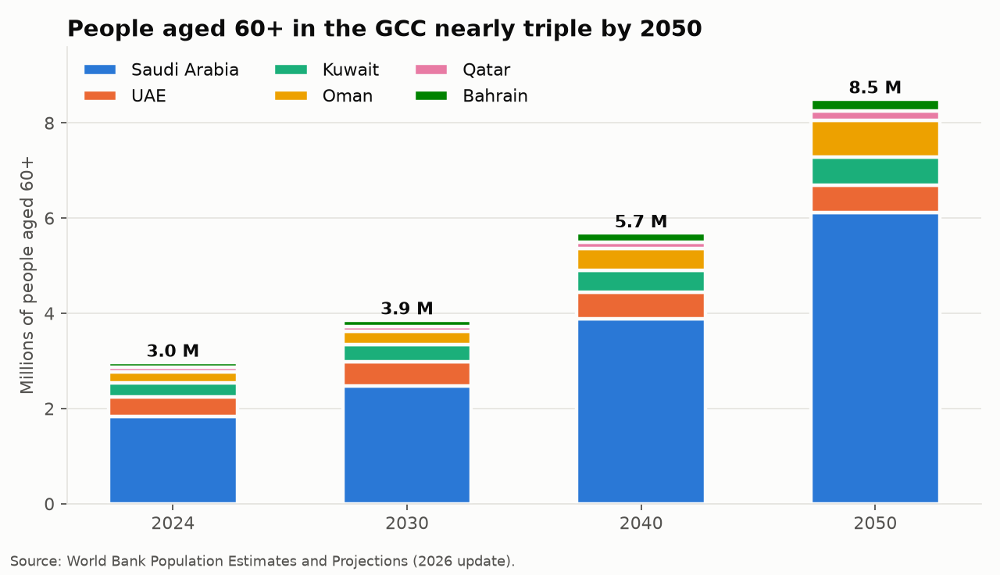
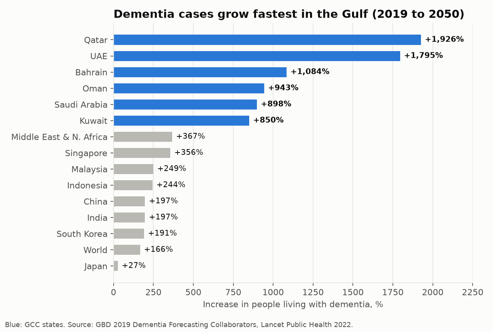
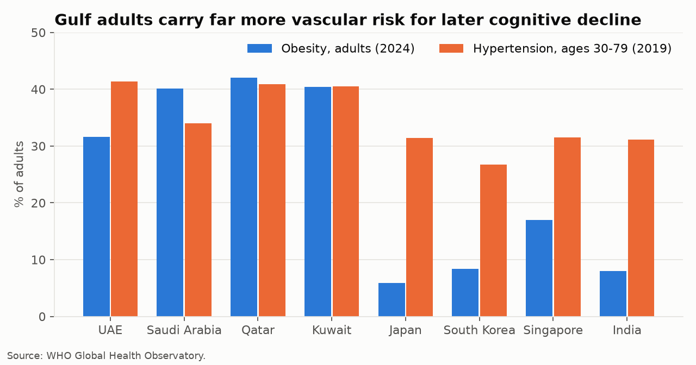
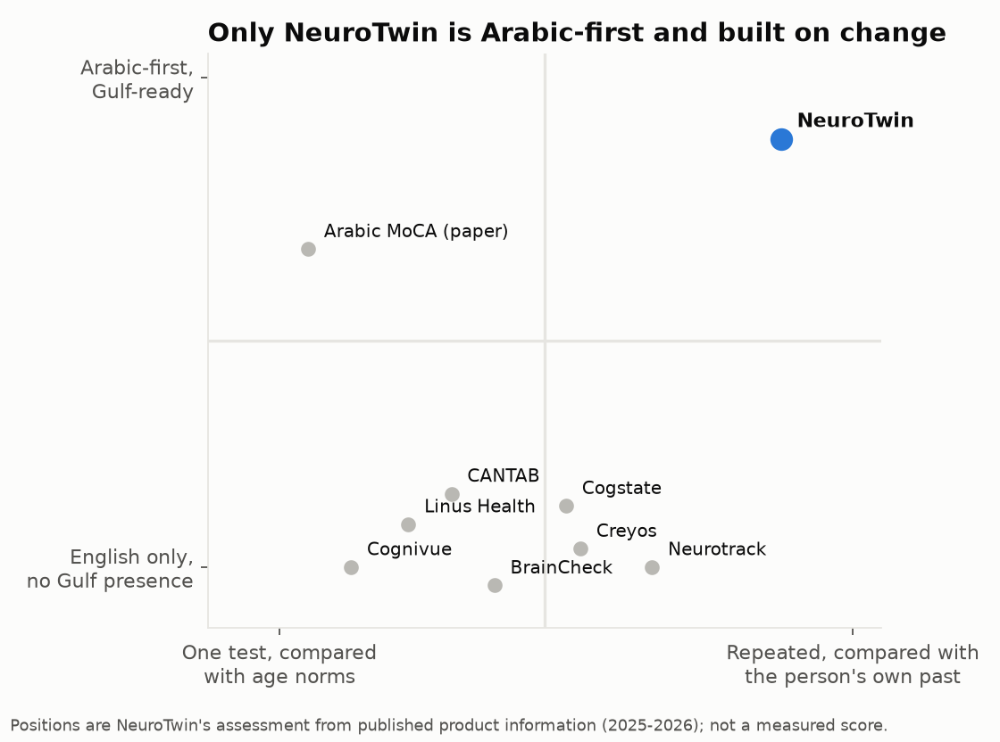
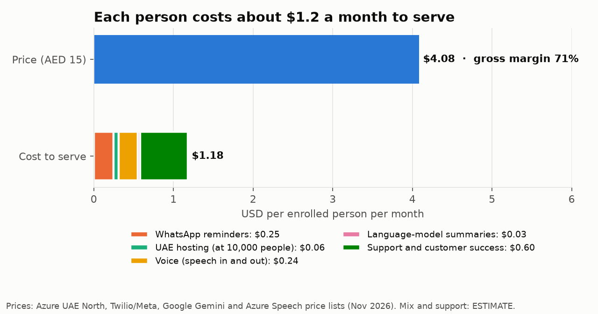
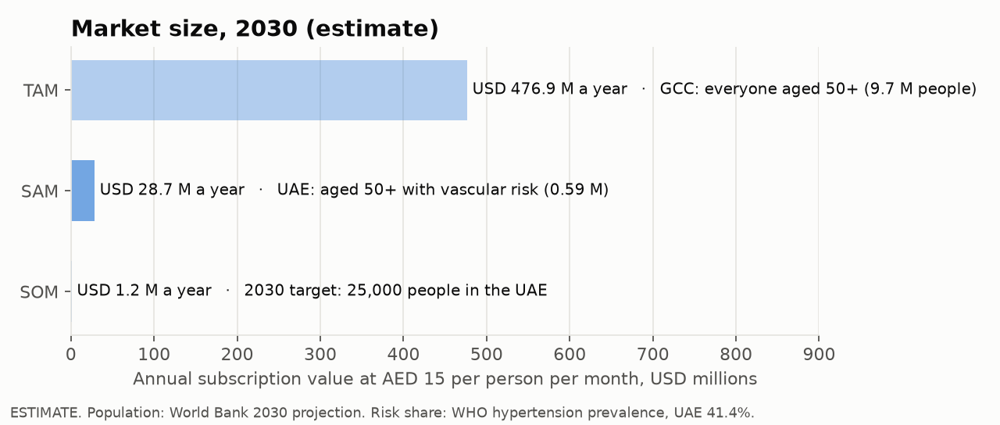
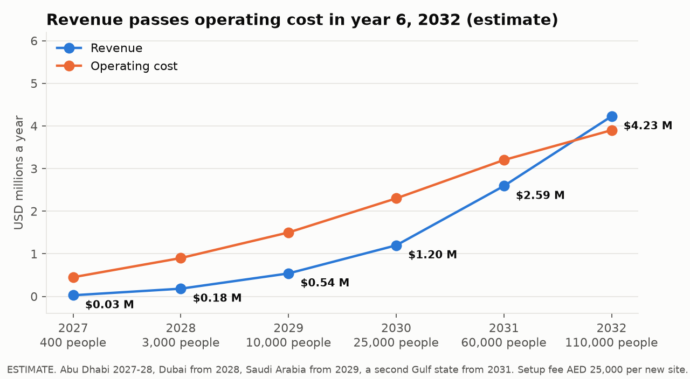

# Business case: who pays, what it costs, how big the market is, and how NeuroTwin grows

**Status:** prepared 16 November 2026 for the Future Health Digital Innovation Challenge. Facts carry a source
(listed at the end). Prices, market sizes and the financial plan are **NeuroTwin's own estimates**; they are marked
*Estimate* and show their arithmetic. The Abu Dhabi telemedicine tariff, licensing and data-residency rules were
checked against official sources (section 6). Facts that could not be checked are in
[section 12](#12-to-confirm-before-the-pilot) and are not used as facts anywhere else.
Charts are generated by [`docs/business/make_charts.py`](business/make_charts.py).

## 1. On one page

| | |
|---|---|
| **The need** | People aged 60+ in the GCC go from 3.0 M (2024) to 8.5 M (2050). Dementia cases in the UAE are forecast to rise **18-fold** (+1,795%) from 2019 to 2050, the fastest growth in the world, against +166% globally. Most dementia is never diagnosed (61.7% undetected in a pooled analysis). |
| **The gap** | No verified competitor offers Arabic or works in the Gulf. Existing tools test once in a clinic against age norms that are biased by education and first language. A 2025 review of 20 Arabic cognitive tools names *detecting change over time* as an open gap. |
| **What NeuroTwin sells** | A clinician-review service: older adults do short activities at home in Arabic or English; the clinician sees whether a person has changed **against their own past**, with the conditions of the day, and decides. |
| **Who pays** | Health-care providers first (primary-care networks and memory clinics, who must show quality and must connect to Malaffi), then payers and employers. Families never pay for results; a consumer tier comes later and makes no clinical claim. |
| **Price** *(Estimate)* | **AED 15 per enrolled person per month** (about USD 4.08), clinician seats included, plus **AED 25,000 setup** per site. Volume price AED 10-12. |
| **Cost to serve** *(Estimate from 2026 price lists)* | About **USD 1.18 per person per month**, hosting in the UAE included. Gross margin about **71%**. |
| **Market** *(Estimate, 2030)* | TAM USD 477 M a year (all GCC adults 50+). SAM USD 28.7 M (UAE adults 50+ with vascular risk). SOM USD 1.2 M (25,000 people). |
| **Plan** *(Estimate)* | Abu Dhabi 2027, Dubai 2028, Saudi Arabia 2029. Revenue passes operating cost in **2032** at about 110,000 people. Funding need about **USD 4 M** to break-even. |

## 2. The problem in numbers



- **Ageing is fast and recent.** GCC people aged 60+: 2.97 M (2024) → 3.86 M (2030) → 5.68 M (2040) → 8.50 M (2050).
  Saudi Arabia alone goes from 1.84 M to 6.12 M. The UAE had 1.33 M people aged 50+ in 2024, 1.42 M by 2030
  (World Bank projections).



- **Dementia grows fastest in the Gulf.** Forecast cases 2019 → 2050: UAE 11,711 → 221,672; Saudi Arabia 85,735 →
  855,760; GCC about 137,000 → 1.52 M (GBD 2019 forecast, Nichols et al. 2022).
- **Most of it is missed.** 61.7% of dementia is undetected (Lang et al. 2017); Alzheimer's Disease International
  estimates about three quarters worldwide. In Saudi primary care, cognitive screening reached only 21.7% of eligible
  people in 2023; **34.2% of those screened got a new diagnosis of MCI or dementia, and 71.3% of them had no prior
  documented concern** (Almohammadi et al. 2026). That is the hidden pool a home-based, repeatable check reaches.
- **MCI is common:** 15.56% of community-dwelling adults aged 50+ (Bai et al. 2022). This is the group where change
  over time matters most and where action (risk-factor control, review of medicines, hearing and sleep) helps.



- **The Gulf carries unusual vascular risk.** Adult obesity 31.6-42.0% in the UAE, Saudi Arabia, Qatar and Kuwait
  against 5.9% in Japan; hypertension 34-46% (WHO). In a Saudi records study, vascular dementia was 23.6% of cases and
  diabetes and hypertension the leading comorbidities (Beigh et al. 2024). These are the people primary care already
  sees every few months for chronic disease, which is where NeuroTwin plugs in.
- **The cost is large.** Dementia cost the world USD 1.3 trillion in 2019 (WHO), heading for USD 2.8 trillion by 2030
  (ADI); about 40% is informal care by families.

## 3. Target users

| Who | Role | What they get | Pays? |
|---|---|---|---|
| **Adults 50-75** with a chronic condition (diabetes, hypertension), a family history, or a worry about memory | Use the personal app 2-3 times a week, in Arabic or English, by touch or voice | Reminders, short activities, their own records, help in an emergency | No (paid for by their provider) |
| **Primary-care doctors and nurses** (Abu Dhabi and Dubai first) | Review "To check", decide, write a care plan | Change against the person's own past, with today's conditions; a draft summary they approve; FHIR export to the record | Through their organisation |
| **Memory-clinic and geriatric teams** | Follow people between visits; triage before costly tests | The same view with a longer history; a referral letter | Through their organisation |
| **Family members** | Encourage, help with the app, write notes | Reminders and messages, **never results** unless the person shares | No |
| **Buyers:** primary-care networks, hospital groups, memory clinics; later insurers, employers, government programmes | Contract per enrolled person | Quality reporting, Malaffi/NABIDH-ready records, a population view | **Yes** |

Priority group for the first contracts: **adults 50-75 already in chronic-disease programmes**. They are seen
regularly, carry vascular risk, and their clinician has a reason to watch cognition.

## 4. Why NeuroTwin is different



| | Typical competitor | NeuroTwin |
|---|---|---|
| What is measured | One test, compared with age norms | Change against the person's **own** past (95% interval, z-score, reliable change index), with practice sessions set aside |
| Fairness | Norms from Western, highly educated samples; a 2023 review found digital tests rarely evaluated across education levels and cultures | Each person is their own baseline; education and first language recorded and analysed by subgroup |
| Language | English (none of the verified competitors offers Arabic or works in the Middle East) | Arabic-first with right-to-left layout, English, voice |
| Setting | Clinic, 5-30 minutes, staff time | Home, 2-5 minutes, a few times a week; the clinician only looks when there is something to check |
| Conditions of the day | Not recorded | Vision, hearing, sleep, setting, feeling unwell, before every activity, used to label quality |
| Family | Not involved | Supports without seeing results |
| Interoperability | Varies | FHIR R4 export today, Malaffi route designed |
| Regulatory status | Only Cognivue (De Novo 2015) and CANTAB Mobile (510(k) 2017) hold a US premarket record; most others are only listed under a 510(k)-exempt code | Positioned as clinician decision support, no diagnosis; device route planned (section 8) |

The Arabic alternative today is paper: the Arabic MoCA (92.3% sensitivity, 85.7% specificity for MCI in a Cairo
study) is a single test given by a trained person. A 2025 review of 29 validation studies of 20 Arabic tools found
only 3 tools validated more than once and names change over time as a gap.

## 5. Where NeuroTwin fits in the care pathway that is coming

The pathway for Alzheimer's disease is changing fast, and it needs a cheap first step:

```
Risk or worry ──▶ NeuroTwin: change over time at home ──▶ clinician decides ──▶ blood test ──▶ PET or CSF ──▶ specialist ──▶ treatment
                  (cheap, repeatable, Arabic)                                  (55+, with symptoms;
                                                                               "not a screening test")
```

- The FDA cleared the first Alzheimer's blood test (Lumipulse pTau217/Aβ42) on 16 May 2025, for adults 55+ **with
  signs and symptoms**; the FDA says it is not for screening. Someone has to document the change first.
- Anti-amyloid treatments are approved in the US (lecanemab 2023, donanemab 2024), the UK, Korea and the EU;
  subcutaneous lecanemab maintenance was approved in the US in August 2025.
- RAND modelled specialist capacity as the bottleneck: an average **18.6-month wait** and 2.1 million people
  progressing to dementia on waiting lists in the US alone. Good triage is what keeps specialists for those who need
  them.

NeuroTwin does not diagnose. It gives the primary-care clinician a documented, fair reason to act or to wait.

## 6. Business model

### Who pays, in order

1. **Health-care providers** (first contracts). Abu Dhabi primary-care networks, hospital groups with memory clinics,
   private groups in Dubai. Why they buy: chronic-disease quality targets, a way to follow people between visits, and
   records that flow into the health record they already must connect to Malaffi (compulsory for every DoH-licensed
   facility; a facility that is not connected cannot renew its licence or claim from Daman).
2. **Payers and government programmes** (from year 3). Insurers (Daman in Abu Dhabi; Dubai's health insurance is
   compulsory and employer-paid), and public healthy-ageing programmes, once the pilot shows usable records and
   clinician uptake.
3. **Employers** (Dubai, from year 3). Staff 50+ and their parents, through the employer's health insurer or wellness
   budget.
4. **Research** (any time, not in the plan). Arabic-speaking cohorts for universities and trials. The established
   players (Cogstate, Cambridge Cognition) earn most of their revenue from clinical trials.
5. **Families** (later, not in the plan). A wellness-only version without clinical claims; never paid access to
   someone else's results.

### What Abu Dhabi already pays for *(checked against official rules, November 2026)*

- **There is a paid telemedicine tariff.** DoH Addendum 30 to the Claims and Adjudication Rules (effective
  31 July 2023) sets prices "to encourage providers to invest in this type of technology". Among them:
  - CPT 99091, a clinician's review and interpretation of health data the patient sent digitally (at least
    30 minutes): **AED 200**.
  - Telephone or video review visits (99441-99443): AED 35 / 65 / 100.
  - Clinician-to-clinician tele-consults (99446-99448): AED 44 / 80 / 125.
- **Thiqa members are named in the rule.** For them, paediatricians and obstetricians may also see new patients by
  telemedicine. Every telemedicine claim needs an eligibility check, and the rules apply to claims to Daman.
- **The limits matter.**
  - The rate includes all materials, and hardware or transmission is not paid separately. A software fee therefore
    cannot be billed on its own. It has to come out of the clinician's paid review.
  - Telemedicine must be started by the patient (tele-consults between clinicians are the exception).
  - There is no separate payment within 7 days of an earlier visit for the same problem.
- **Licensing.** The DoH Standard on Tele-Medicine (2020) covers tele-monitoring and requires a DoH facility licence.
  Dubai's DHA Telehealth Standards (v2.0, 2023) recognise remote patient monitoring and require consent forms in
  Arabic and English.
- **Data stays in the UAE.** Federal Law No. 2 of 2019, Article 13 bars processing health data outside the UAE,
  except under a ministerial resolution or with the patient's explicit consent. Records must be kept for at least
  25 years.

What this means: a provider that does one 30-minute review of a person's NeuroTwin record a year can bill AED 200
under 99091. That is more than NeuroTwin's AED 180 yearly fee for that person. **The price stays at AED 15 per person
per month on purpose.** A deep-research draft suggested AED 30 (see business/RESEARCH_REPORT.md), which would cost more
than one billable review. At AED 15, a provider covers the cost from work it can already bill.

Whether a given review qualifies under 99091 depends on the clinician's documented time and on the patient-initiated
rule. We will confirm this with DoH and the provider's coding team in the pilot (section 12).

### Price *(Estimate)*

| Tier | Price | Includes |
|---|---|---|
| Clinic programme | **AED 15 per enrolled person per month** (USD 4.08), minimum 100 people | Personal app, family app, clinician seats, FHIR export, support |
| Network or payer programme | AED 10-12 per person per month above 5,000 people | Plus population reporting and integration to the network's health record |
| Setup per site | AED 25,000 once | Integration with the site's health record, training, go-live |
| Research licence | Per study (to be quoted) | Arabic and English activities, data export, study support |

Why this price: about AED 180 (USD 49) per person **per year**, less than one specialist cognitive assessment
(the US Medicare rate for a cognitive assessment and care-plan visit, CPT 99483, was USD 266 in 2025; testing codes
USD 34-125). In Abu Dhabi, the yearly fee is also below one AED 200 remote-data review (CPT 99091, DoH Addendum 30).

### Cost to serve *(Estimate built from 2026 price lists)*



- Hosting in the UAE (Azure UAE North or AWS UAE) is 16-30% dearer than US regions but tiny per person: a minimal
  stack costs about USD 115-205 a month in total.
- A 300-word clinician summary costs USD 0.001-0.014 with a language model; the choice of model is about keeping
  data in the UAE, not price.
- The largest variable cost is messages: SMS to the UAE costs USD 0.1176 per message (Twilio), so reminders go by
  WhatsApp or in-app wherever the person agrees.
- Support and customer success (USD 0.60) is the biggest line and is an estimate.

## 7. Market size *(Estimate)*



Built bottom-up from population, not from vendor market reports:

| | Arithmetic | Annual value |
|---|---|---|
| **TAM**: every adult 50+ in the GCC, 2030 | 9.73 M people × AED 180 a year ÷ 3.6725 | **USD 477 M** |
| **SAM**: UAE adults 50+ with vascular risk, 2030 | 1.415 M × 41.4% (hypertension, WHO) × AED 180 ÷ 3.6725 | **USD 28.7 M** |
| **SOM**: 2030 target | 25,000 people × AED 180 ÷ 3.6725 | **USD 1.2 M** |

**Asia** adds a far larger pool for licensing: adults 50+ in 2030 number 63.6 M in Japan, 25.1 M in South Korea,
2.2 M in Singapore, 9.3 M in Malaysia and 76.3 M in Indonesia (World Bank). Prices there would differ (health spend
per person is USD 3,638 in Japan, USD 132 in Indonesia), so Asia is not added to the TAM.

For context only (vendor estimate, low confidence): Grand View Research values global digital therapeutics at
USD 9.5 B in 2025, rising to USD 75.2 B by 2033.

## 8. Go-to-market: Abu Dhabi, Dubai, the Gulf, then Asia

| Phase | Market | How | Regulatory and integration route |
|---|---|---|---|
| 2027 | **Abu Dhabi** | One DoH-licensed provider partner; ethics-approved pilot (see [DECIDE_AI.md](DECIDE_AI.md)); then paid clinic programme | NeuroTwin sends FHIR to the provider's health record, which feeds Malaffi ([INTEGRATION_DESIGN.md](INTEGRATION_DESIGN.md)); meet ADHICS as the provider's supplier; data stays in the UAE |
| 2028 | **Dubai** | Private hospital groups and clinics; employers through their insurers | Same route through NABIDH (Riayati, Malaffi and NABIDH announced they were linked in 2023); Dubai Healthcare City has its own regulator for free-zone providers |
| 2029 | **Saudi Arabia** | Health clusters and private groups; the largest GCC market (6.1 M aged 60+ by 2050) | SFDA software-as-medical-device guidance if clinical claims are made; integration with the national platform to be confirmed |
| 2031 | **Second Gulf state** (Qatar, Kuwait, Oman or Bahrain) | Partner-led | National regulator; reuse the UAE evidence |
| 2031+ | **Asia** | Singapore first (HSA has a reliance route for software already approved by reference regulators; Healthier SG enrols people with a GP); Malaysia and Indonesia with partners; Japan and Korea by licensing the change engine to local companies | Local language and validation by partners |

**Regulation in one line:** today NeuroTwin makes no diagnostic claim and keeps a clinician deciding, which is the
lowest-risk position. A claim about detecting MCI or dementia would make it software as a medical device; the
Emirates Drug Establishment has been the single UAE regulator for medical products, devices included, since 2023,
and a new federal law on medical products was published in October 2024. The plan is to collect the pilot evidence
first, then decide on a device claim with a regulatory adviser.

## 9. Financial plan *(Estimate)*



| Year | People enrolled (average) | Price, AED per person per month | New sites | Revenue, USD M | Operating cost, USD M |
|---|---|---|---|---|---|
| 2027 | 400 | 15 | 1 | 0.03 | 0.45 |
| 2028 | 3,000 | 15 | 5 | 0.18 | 0.90 |
| 2029 | 10,000 | 14 | 12 | 0.54 | 1.50 |
| 2030 | 25,000 | 13 | 20 | 1.20 | 2.30 |
| 2031 | 60,000 | 12 | 35 | 2.59 | 3.20 |
| 2032 | 110,000 | 11 | 40 | 4.23 | 3.90 |

Revenue = people × price × 12 + new sites × AED 25,000, converted at 3.6725. The cumulative shortfall from 2027 to
2031 is about **USD 3.8 M**, which sets the funding need at about **USD 4 M** (a seed round for the Abu Dhabi pilot
and first contracts, then a round for Dubai and Saudi Arabia). Research licences and a family tier are upside and
are not counted. Operating costs (team, compliance, sales) are planning estimates; UAE salaries and compliance costs
are still to be priced.

## 10. The market to 2035 and beyond

- **More older people, especially in Saudi Arabia and Oman.** The GCC 60+ population nearly triples by 2050.
- **Earlier diagnosis becomes normal.** Blood tests and new treatments make "who should be tested, and when?" a daily
  question in primary care. Tools that document change cheaply become the front door.
- **Prevention matters.** Vascular risk is high in the Gulf; a programme that watches cognition alongside diabetes
  and blood pressure care is a natural extension of chronic-disease management.
- **Records must move.** Malaffi now carries LOINC-coded lab data from over 3,000 facilities (90% of lab results)
  and added an AI physician assistant in November 2026. Anything that cannot send standard records will be left out.
- **Arabic and fairness become requirements.** Western-normed tools struggle with education and language
  differences; a within-person method is fairer by design.

## 11. Risks and how we handle them

| Risk | Mitigation |
|---|---|
| Providers do not pay without a tariff | Start with providers that have quality targets; publish pilot results; price below one specialist visit a year |
| Telemedicine codes do not cover the software itself | Abu Dhabi pays clinician review of remotely sent data (99091, AED 200), but not hardware or transmission; price the software below one billable review and sell it per enrolled person to providers |
| Regulatory reclassification | No diagnostic claim; clinician decides; device route prepared, not assumed |
| Older adults stop using it | 2-5 minute activities, voice, reminders, family support; completion is a primary pilot outcome |
| Data residency and security | Hosting in UAE regions; ADHICS alignment; audit log; no data to non-UAE AI providers outside demos |
| Large competitor adds Arabic | Lead with within-person method, Gulf integration and local evidence; licence the engine |

## 12. To confirm before the pilot

These were not verifiable during the research and are **not** used as facts above:
- Whether Daman and Thiqa accept 99091 for review of cognitive-activity records in practice. The tariff is verified
  (section 6), but Daman publishes no adjudication rule on telemedicine or remote monitoring that we could find, and
  Thiqa's public benefit list names physician consultations and outpatient psychiatry, not digital monitoring.
- Whether Dubai (DHA) insurers have a tariff for remote monitoring like Abu Dhabi's. A broker guide (eSanad, March
  2026) says telehealth visits are widely covered, but this is not an official source.
- The DoH and DHA AI policies and the Healthy Longevity Medicine framework. Which ministerial resolutions grant
  exceptions under Article 13 of Federal Law No. 2 of 2019.
- SFDA guidance numbers and fees; EDE fees and timelines.
- UAE salaries, compliance costs (ISO 27001, penetration tests, ADHICS audit), free-zone and Hub71 terms.
- Statistics Centre Abu Dhabi and Dubai Statistics Center age tables, split by nationals and residents.
- Lancet Commission 2024 headline figures; approvals of anti-amyloid drugs in the UAE or Saudi Arabia.
- Published list prices of competitor products (none of those we could reach publishes one).

## Sources

- Population 2024-2050: World Bank, Population Estimates and Projections (2026 update), databank.worldbank.org/source/population-estimates-and-projections
- Dementia forecast: GBD 2019 Dementia Forecasting Collaborators (Nichols et al.), *Lancet Public Health* 2022, https://pmc.ncbi.nlm.nih.gov/articles/PMC8810394/
- Undetected dementia: Lang et al., *BMJ Open* 2017, https://pubmed.ncbi.nlm.nih.gov/28159845/
- MCI prevalence: Bai et al., *Age Ageing* 2022, https://pubmed.ncbi.nlm.nih.gov/35977150/
- Saudi primary-care screening: Almohammadi et al. 2026, https://pubmed.ncbi.nlm.nih.gov/42696526/
- Saudi dementia subtypes: Beigh et al., *Cureus* 2024, https://pubmed.ncbi.nlm.nih.gov/38371043/
- Risk factors: WHO Global Health Observatory, https://www.who.int/data/gho
- Health spending: World Bank, https://data.worldbank.org/indicator/SH.XPD.CHEX.PC.CD
- Dementia cost: WHO fact sheet, https://www.who.int/news-room/fact-sheets/detail/dementia; ADI, https://www.alzint.org/about/dementia-facts-figures/dementia-statistics/
- Arabic tools review (2025) and Arabic MoCA: Rahman & El Gaafary 2009, https://pubmed.ncbi.nlm.nih.gov/19260980/
- Digital tests and diverse populations: Cubillos & Rienzo, *JMIR Ment Health* 2023, https://pubmed.ncbi.nlm.nih.gov/38064247/
- FDA device records: openFDA, https://api.fda.gov/device/classification.json?search=product_code:PKQ
- Alzheimer's blood test: FDA, https://www.fda.gov/news-events/press-announcements/fda-clears-first-blood-test-used-diagnosing-alzheimers-disease
- Specialist capacity: RAND RR2272, https://www.rand.org/pubs/research_reports/RR2272.html
- US reimbursement: BrainCheck billing guide 2025, https://braincheck.com/billing-and-documentation-considerations; CMS GUIDE model, https://www.cms.gov/priorities/innovation/innovation-models/guide
- Malaffi: https://www.malaffi.ae/providers/facilities-required-to-connect/, https://www.malaffi.ae/beyond-connectivity-malaffi-marks-90-loinc-adoption-laying-the-foundation-for-intelligent-healthcare/
- Abu Dhabi telemedicine tariff: DoH Claims and Adjudication Rules, Addendum 30 (effective 31 July 2023), https://www.doh.gov.ae (Shafafiya, Adjudication Rules)
- DoH Standard on Tele-Medicine 2020: Al Tamimi & Co., https://www.tamimi.com/news/abu-dhabi-uae-doh-telehealth-standard-2020/
- Federal Law No. 2 of 2019 Art. 13, retention, DHA Telehealth Standards v2.0: Nour Attorneys (2026), https://www.nourattorneys.com/articles/uae-healthcare-sector-remote-patient-monitoring
- Thiqa benefits: https://www.thiqa.ae/benefit/; Daman adjudication rules: https://www.damaninsurance.ae/healthcare/coverage-information/
- Telehealth cover in UAE plans (broker guide, not official): https://www.esanad.com/blog/telehealth-uae-health-insurance-coverage-2026
- Emirates Drug Establishment: https://www.ede.gov.ae/en/legislations
- Singapore HSA: https://www.hsa.gov.sg/medical-devices/guidance-documents/; Healthier SG, https://www.healthiersg.gov.sg/
- Cloud and messaging prices: https://prices.azure.com/api/retail/prices, AWS price lists, https://ai.google.dev/gemini-api/docs/pricing, https://www.twilio.com/en-us/sms/pricing/ae, https://www.twilio.com/en-us/whatsapp/pricing
- Digital therapeutics market (vendor estimate): https://www.grandviewresearch.com/industry-analysis/digital-therapeutics-market
- Lumosity and the FTC: https://www.ftc.gov/news-events/news/press-releases/2016/01/lumosity-pay-2-million-settle-ftc-deceptive-advertising-charges-its-brain-training-program
